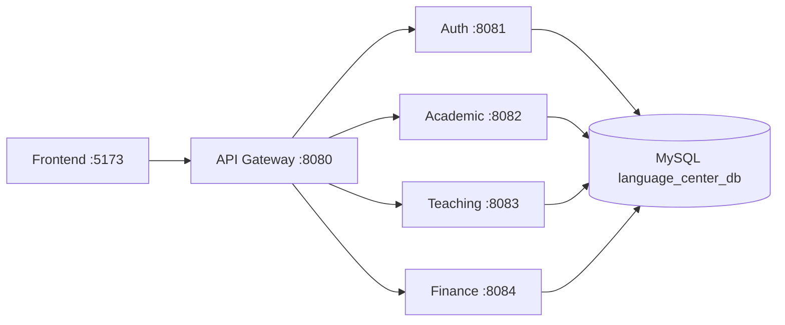

**Khắc phục AI chậm (13/11/2026):** Google trả 503 quá tải cho Gemini 3.8; đã đổi sang gemini-3.1-flash-lite theo lựa chọn người dùng. Bốn luồng Gemini + MCP thật trên dữ liệu tổng hợp đạt, khoảng 1,3–4,8 giây/luồng; thêm timeout 10 giây và cooldown sau lỗi. 124 test assistant, 121 frontend đạt; 1 live opt-in skip trong bộ mặc định. [Bằng chứng, cấu hình và cách restart](docs/assistant/troubleshooting.md). C7 với API nghiệp vụ/MySQL thật vẫn chưa hoàn tất.

**Trợ lý — C6 (13/11/2026):** đã có drawer chat Ant Design + styled-components cho bốn role web, card/choice/phân trang, scope, điều hướng chi nhánh và xử lý lỗi/response cũ. 119 test web, 123 assistant và 10 gateway đạt tại mốc C6, 1 live opt-in skip; build web/backend đạt. [Bàn giao, ảnh UI và cách chạy C6](docs/assistant/c6-completion.md). Bản sửa model và kiểm thử bổ sung ở ghi chú phía trên.

**Trợ lý — C5 (13/11/2026):** đã tăng cường kiểm chủ đề/scope, dữ liệu chứa injection, body chunked/JSON, link điều hướng, quota theo account và audit không lộ nội dung. 123 test assistant đạt, 1 live opt-in skip. [Bàn giao C5 và hạn mức](docs/assistant/c5-completion.md). C5 không đổi database/web/mobile; C6 phía trên bổ sung UI.

**Trợ lý — C4 (13/11/2026):** đã có backend Gemini + MCP, 3 API assistant, hội thoại theo phiên/scope, chọn thực thể trùng tên và kết quả từ dữ liệu nguồn. 61 test assistant và 9 gateway đạt tại mốc C4; 1 live smoke skip trong bộ mặc định. Gemini thật chưa nghiệm thu do timeout/503. [Bàn giao C4 và cách cấu hình](docs/assistant/c4-completion.md).

**Trợ lý — C3 (13/11/2026):** thêm assistant-service và MCP nội bộ chỉ đọc bằng SDK Java 2.0.0; 24 test cùng JAR smoke đạt tại mốc C3. [Bàn giao C3, schema và cách chạy](docs/assistant/c3-completion.md). C4 phía trên bổ sung HTTP chat và Gemini.


**Trợ lý — C2 (13/11/2026):** đã bổ sung 13 API chỉ đọc, lọc tiền khóa học, truy vấn học viên/lớp/điểm danh/điểm và ưu tiên lead theo quyền. 470 test ba service thay đổi đạt (28 test C2 mới). [Bàn giao, API và cách chạy](docs/assistant/c2-completion.md). Khởi động lại academic/finance/teaching; không có migration mới, chưa gọi Gemini hoặc triển khai MCP/chat UI.

**Trợ lý Gemini + MCP — C1 (13/11/2026):** đã hoàn thành khảo sát, phạm vi nghiệp vụ, ma trận quyền, danh mục công cụ và bộ nghiệm thu dự kiến. [Kế hoạch C1–C7 và tài liệu C1](docs/assistant/README.md). Chưa triển khai runtime chatbot hoặc gọi model; bước tiếp theo là C2.


**Web W6–W8 (13/11/2026):** đã triển khai học vụ/giảng dạy, dashboard theo role và chuẩn hóa UI. 518 test backend, 109 web, 81 mobile đạt. [Bàn giao, ảnh, cách chạy và nghiệm thu còn lại](docs/improvements/web-w6-w7-w8-completion.md). Khởi động lại academic/finance; không có migration mới. UI tự động dùng fixtures; chưa nghiệm thu APK trên điện thoại và hệ thống thật cho đợt này.


**Web W3–W5 (13/11/2026):** đã cập nhật tìm kiếm/liên kết tài chính, hỗ trợ gắn UUID giao dịch và hồ sơ học viên. [Bàn giao, API, migration và cách chạy bản mới](docs/improvements/web-w3-w4-w5-completion.md). Cần chạy lại academic/finance/teaching; không tạo lại database. [Lộ trình web](docs/improvements/web-management-upgrade-roadmap-2026-11-13.md).

**Giai đoạn 6 hoàn thành (11/11/2026):** [Báo cáo và ZIP bàn giao](docs/reviews/2026-11-11-phase-6-completion.md). Đúng gói release đạt 86 ca tích hợp, UI 4 role và backup/restore; ZIP 990 file đã đối chiếu hash. Còn thông tin khảo sát và hồ sơ nộp cần bổ sung.

**Cập nhật giai đoạn 5 (11/11/2026):** [Nghiệm thu bản hiện tại và backup/restore](docs/reviews/2026-11-11-phase-5-completion.md):335 BE,96 FE,86 ca tích hợp,12 UI bổ sung trước/sau restore. F13/V011 đã sửa trên database gốc sau backup, dữ liệu/tài khoản giữ nguyên. Bản ZIP mới thuộc giai đoạn6.


**Cập nhật giai đoạn 4 (11/11/2026):** [Bộ demo qua API thật:40 API+8SQL+4UI](docs/reviews/2026-11-11-phase-4-completion.md), [lệnh mở/tái tạo](scripts/demo-phase4/README.md). Database nguồn giữ nguyên; phát hiện F13 cần đối chiếu migration V011 của schema nguồn.


**Cập nhật giai đoạn 3 (11/11/2026):** [Time-grid: URL, bộ lọc và tách nguồn tải dữ liệu](docs/reviews/2026-11-11-phase-3-completion.md); 96 tests FE đạt, browser với API giả lập.


**Cập nhật giai đoạn 2 (11/11/2026):** [Lịch sử trước/sau, trang chương trình và dọn code cũ](docs/reviews/2026-11-11-phase-2-completion.md); 89 tests FE đạt, chưa nghiệm thu lại full-stack.


**Rà soát hiện trạng 11/11/2026:** [Giai đoạn 1 — ma trận yêu cầu, 12 công việc và lộ trình sửa](docs/reviews/2026-11-11-phase-1-current-state.md). Phân biệt source hiện tại, fixture xem UI và bằng chứng G20 trước cập nhật; chưa nghiệm thu lại toàn hệ thống.


**Nghiệm thu lại G17–G18 ngày 10/11/2026:** 86 kiểm tra API/MySQL/Edge thật đạt trên schema riêng; source database không đổi. [Hướng dẫn chạy/demo](deployment/acceptance-g17-g18.md) · [G17](docs/thesis-progress/G17.md) · [G18](docs/thesis-progress/G18.md). G15–G16 đã sửa theo source; [G19](docs/thesis-progress/G19.md) đã đồng bộ bản thảo/demo/slide và số liệu. [G20](docs/thesis-progress/G20.md) đã đạt release local900artifact,86ca, restore và demo4role; bản nộp/production còn checklist.

Backend quản lý trung tâm ngoại ngữ nhiều chi nhánh, gồm **4 service nghiệp vụ và 1 API Gateway**.
[Mở demo release đã phục hồi](deployment/defense-rehearsal-checklist.md) · [Hồ sơ bàn giao](docs/thesis-progress/G20.md).

Bản thảo khóa luận: [mục lục](docs/thesis/report/index.md) · [demo](docs/thesis/report/kich-ban-demo.md) · [nội dung slide/hỏi đáp](docs/thesis/report/slide-va-cau-hoi-bao-ve.md).

Stack hiện tại: Java 21, Spring Boot 4.1.1, Maven, MySQL; kiểm thử dùng H2/mock/HTTP stub.
Ngày nghiệp vụ dùng múi giờ `Asia/Ho_Chi_Minh`.

## Cập nhật: cải thiện giai đoạn 1–2

Đã hỗ trợ Admin/Teacher nhiều chi nhánh, Staff tối đa một chi nhánh; Super Admin phân công và xem lịch sử.
Sidebar có bộ chọn chi nhánh; dashboard/báo cáo Admin có chế độ tất cả chi nhánh được giao.
Áp dụng migration V001 trước khi chạy bản mới. Database local đã chuyển dữ liệu, không cần tạo lại.
Chi tiết: [Quyền, API, migration và hướng dẫn](docs/improvements/phase-one-multi-branch.md).

Đã hoàn thiện đổi/cấp lại mật khẩu, bắt buộc đổi mật khẩu tạm, đăng xuất tất cả phiên và sửa liên hệ cá nhân. Áp dụng thêm migration V002; mật khẩu tài khoản local hiện có được giữ nguyên.
Hướng dẫn: [Cải thiện giai đoạn 2](docs/improvements/phase-two-account-security.md).

## Tra cứu nhanh

| Cần tìm | Tài liệu |
|---|---|
| Lộ trình hoàn thiện theo đề cương khóa luận (07/11/2026) | **[Kế hoạch T1–T6 và tiêu chí nghiệm thu](docs/thesis-completion-roadmap.md)** |
| G01: yêu cầu, quy tắc và bàn giao triển khai | [Bộ tài liệu khóa luận](docs/thesis/README.md) · [Bàn giao G01](docs/thesis-progress/G01.md) |
| Toàn bộ endpoint, method, quyền và query | **[Danh sách 173 API hiện có](docs/api-list.md)** |
| Body mẫu, response, trạng thái và quy tắc gọi API | [Hợp đồng API](docs/api-contracts.md) |
| Lý do chọn các quy tắc nghiệp vụ | [Quyết định triển khai](docs/implementation-decisions.md) |
| Sơ đồ class theo service | [Domain model — PlantUML](docs/domain-model.puml) |
| Chạy với dữ liệu MySQL cũ | [Migration](docs/migrations/README.md) |
| Kết quả kiểm thử và giới hạn đã xác minh | [Verification](docs/verification.md) |
| Frontend giai đoạn 1: Chi nhánh, Tài khoản và phiên đăng nhập | [Giai đoạn 1](../../language-center-web-frontend/docs/phase-one.md) |
| Frontend giai đoạn 2: Khóa học, Phòng, Lớp và Lịch | [Giai đoạn 2](../../language-center-web-frontend/docs/phase-two.md) |

Tài liệu trong `docs/api-list.md` và `docs/api-contracts.md` mô tả code hiện tại.
Những tài liệu có nhãn **Historical reference** và collection Postman academic cũ chỉ để tham khảo.

## 1. Kiến trúc và cổng

Frontend gọi `http://localhost:8080/api/v1/...`. Khi kiểm tra riêng service, đổi cổng và giữ nguyên path.

| Service | Cổng | Prefix | Trách nhiệm | API chính |
|---|---:|---|---|---:|
| auth-service | 8081 | `/api/v1/auth` | Đăng nhập, tài khoản, phân công chi nhánh, hồ sơ nhân sự, danh sách giáo viên | 24 |
| academic-service | 8082 | `/api/v1/academic` | Chi nhánh, Lead, học viên, khóa, phòng, lớp, lịch, đăng ký, điểm danh, thống kê vận hành | 135 |
| teaching-service | 8083 | `/api/v1/teaching` | Bài kiểm tra, điểm, lịch sử sửa điểm, tài liệu và đánh giá | 37 |
| finance-service | 8084 | `/api/v1/finance` | Học phí, phiếu thu, công nợ và báo cáo doanh thu | 17 |
| api-gateway | 8080 | Cả 4 prefix trên | Định tuyến, CORS, chuyển tiếp JWT | Không có controller nghiệp vụ |

Tổng hiện tại: **213 API chính**, thêm 3 alias học phí cũ và 2 endpoint chẩn đoán trực tiếp service.
Gateway giữ nguyên đường dẫn, không bỏ `/api/v1`.



Dùng chung database nhưng mỗi service chỉ truy cập bảng mình sở hữu.
Tham chiếu sang service khác dùng ID, DTO/snapshot và HTTP, không tạo quan hệ JPA xuyên service.
Finance giữ tên bảng cũ `tuition`; API chính dùng `/tuitions`.

| Service gọi | Service nhận | Mục đích |
|---|---|---|
| Auth | Academic | Kiểm tra chi nhánh khi tạo tài khoản |
| Academic | Auth | Xác minh giáo viên và lấy tên chính xác |
| Academic | Finance | Tạo học phí sau khi commit đăng ký |
| Finance | Academic | Đọc đăng ký và giá học phí đã chốt |
| Teaching | Academic | Kiểm tra quyền lớp, khóa học và học viên |

Các lời gọi này chuyển tiếp JWT của người đang thao tác.

## 2. Chạy dự án

### Yêu cầu

- JDK 21; Maven để chạy lệnh ở root, hoặc Maven Wrapper trong từng service.
- MySQL và database `language_center_db`; mặc định kết nối `localhost:3308`.
- Database cũ cần được đối chiếu theo [hướng dẫn migration](docs/migrations/README.md).
- Chạy lệnh dưới đây từ thư mục chứa README này.

### Cấu hình môi trường

Tạo `.env.local` từ [mẫu cấu hình](.env.example) nếu chưa có:

```powershell
if (-not (Test-Path .env.local)) {
    Copy-Item .env.example .env.local
}
```

Điền các biến chính:

| Biến | Ý nghĩa / mặc định |
|---|---|
| `DB_URL` | Một database dùng chung; mặc định MySQL 3308/language_center_db |
| `DB_USERNAME` | Mặc định root |
| `DB_PASSWORD` | Bắt buộc điền |
| `JWT_SECRET` | Bắt buộc, ít nhất 32 byte UTF-8; **cùng một giá trị ở cả 4 service** |
| `JWT_EXPIRATION` | Mặc định 86400000 ms = 24 giờ |
| `DDL_AUTO` | Mặc định update khi phát triển; sau migration đã kiểm chứng nên dùng validate |
| `AUTH_URL / ACADEMIC_URL / TEACHING_URL / FINANCE_URL` | Địa chỉ service; mặc định localhost theo bảng cổng |
| `DOCUMENT_STORAGE` | Tùy chọn; mặc định storage/documents bên trong thư mục chạy teaching |
| `AUTH_BOOTSTRAP_ENABLED` | Mặc định false; khởi tạo SA một lần khi bảng accounts rỗng |

Các file `application.properties` tự import `.env.local` dạng `KEY=value` ở thư mục root
hoặc thư mục service; không cần đặt dấu nháy quanh giá trị. `.env.local` đã được gitignore.
`run-service.ps1` cũng nạp file cấu hình vào tiến trình trước khi chạy Maven.

### Khởi động

Mở **mỗi lệnh trong một terminal riêng**, theo thứ tự:

```powershell
.\scripts\run-service.ps1 academic-service
.\scripts\run-service.ps1 auth-service
.\scripts\run-service.ps1 finance-service
.\scripts\run-service.ps1 teaching-service
.\scripts\run-service.ps1 api-gateway
```

Có thể truyền `-EnvFile <đường-dẫn>` để dùng file cấu hình khác.
Cả 5 service có thể được phát triển/chạy riêng; các thao tác gọi liên service cần service phụ thuộc đang hoạt động.
Academic seed hai chi nhánh ID 1 và 2 khi bảng branches rỗng.

Để dùng Maven cài trên máy thay cho script, mở terminal ở thư mục service và chạy:

```powershell
cd auth-service
mvn spring-boot:run
```

Import `.env.local` được khai báo trong `application.properties`; Maven không tự đọc file này.

### Tài khoản đầu tiên

Nếu bảng `accounts` rỗng, đặt trong `.env.local`:

```dotenv
AUTH_BOOTSTRAP_ENABLED=true
AUTH_BOOTSTRAP_USERNAME=<ten-dang-nhap>
AUTH_BOOTSTRAP_PASSWORD=<mat-khau-rieng>
```

Tên đăng nhập dùng 3–50 ký tự chữ/số hoặc `_.@-`. Mật khẩu bootstrap ít nhất 12 ký tự,
không quá 72 byte UTF-8. Khởi động auth một lần, sau đó tắt bootstrap.
Nếu đã có tài khoản, bootstrap không tạo thêm và không ghi đè.

### Đăng nhập và kiểm tra JWT

Thay hai giá trị minh họa bằng tài khoản thực tế:

```powershell
$baseUrl = "http://localhost:8080"
$loginBody = @{
    username = "<ten-dang-nhap>"
    password = "<mat-khau>"
} | ConvertTo-Json

$login = Invoke-RestMethod -Method Post -Uri "$baseUrl/api/v1/auth/login" `
    -ContentType "application/json" -Body $loginBody
$headers = @{ Authorization = "Bearer $($login.token)" }

Invoke-RestMethod -Uri "$baseUrl/api/v1/auth/me" -Headers $headers
```

Frontend dev origin được cấu hình là `http://localhost:5173`.
Khi gọi qua gateway, gateway xử lý CORS; các service vẫn hỗ trợ gọi trực tiếp khi phát triển.

## 3. Vai trò và quy tắc cần nhớ

| Vai trò | Phạm vi | Quyền chính |
|---|---|---|
| SUPER_ADMIN | Toàn chuỗi | Quản lý chi nhánh, tạo Admin, vận hành và báo cáo toàn hệ thống |
| ADMIN | Một hoặc nhiều chi nhánh được phân công | Quản lý nghiệp vụ, tạo Staff/Teacher, điều chỉnh học phí, sửa điểm có lý do, duyệt tài liệu |
| STAFF | Một chi nhánh | Lead, học viên, lớp và đăng ký, điểm danh, thu tiền; không xem báo cáo doanh thu |
| TEACHER | Một hoặc nhiều chi nhánh; chỉ lớp được giao | Xem lớp/lịch, điểm danh, kiểm tra/điểm, đăng tài liệu; không truy cập tài chính |

- `teacherId` của lớp là **profileId giáo viên**, không phải accountId.
- `recordedBy/enteredBy/uploadedBy` là accountId của người thao tác.
- Phạm vi A/S/T lấy từ phân công hiện tại trong Auth. `X-Branch-Id` chọn chi nhánh làm việc; query/body chỉ được chọn chi nhánh đã phân công. `branchId` của tài khoản là chi nhánh chính.
- SA chọn branchId khi tạo dữ liệu theo chi nhánh; khóa học chung là ngoại lệ với branchId=null.
- Số điện thoại học viên có thể trùng; server sinh studentCode.
- S không tạo khóa học/đổi giá, không sửa lịch; khi sửa lớp phải giữ teacher/room/course/dates.
- Một lớp tối đa một slot cho mỗi ngày trong tuần; sĩ số và xung đột lịch được kiểm tra khi đăng ký/đổi lịch.
- Trạng thái lớp: UPCOMING/ONGOING/FINISHED. Trường `full` thể hiện đủ chỗ; không PATCH FULL.
- Chuyển lớp cùng khóa/cùng chi nhánh giữ billingEnrollmentId và học phí gốc.
- Payment chỉ được thêm; retry dùng lại requestKey, khoản thu không được vượt số dư.
- A/SA chỉ sửa điểm đã có và phải ghi reason; người nhập ban đầu được giữ.
- S chỉ xem/tải tài liệu APPROVED; T chỉ xem/tải tài liệu mình đăng.
- JWT mặc định hết hạn sau 24 giờ. Các service đọc phiên hiện tại từ Auth mỗi request; khóa tài khoản và thu hồi phân công có hiệu lực ở yêu cầu tiếp theo.

Quyền chi tiết và các ngoại lệ có tại [danh sách API](docs/api-list.md).

## 4. Luồng nghiệp vụ để đọc lại nhanh

| Bước | Thao tác |
|---|---|
| Chuẩn bị | SA tạo A; A tạo S/T. Tạo khóa học → phòng → lớp → lịch học. |
| Tư vấn | Tạo Lead → CONTACTED/CONSULTING → POST /leads/{id}/convert → lấy Student ID. |
| Xếp lớp | POST /enrollments với studentId và classId; kiểm tra cùng chi nhánh, sĩ số, lịch. |
| Học phí | Sau commit, academic gọi finance. Nếu lỗi, đăng ký vẫn còn; dùng /enrollments/{id}/tuition/retry. |
| Thu tiền | Tra Tuition → POST /payments cho từng đợt, mỗi khoản thu dùng requestKey riêng. |
| Học tập | Lấy sheet → gửi điểm danh cả lớp. Tạo Exam → PUT Grade. Upload tài liệu → A duyệt. |
| Báo cáo | Academic: vận hành; Finance: doanh thu/công nợ; Teaching: đánh giá học viên. |

Các ID trong body mẫu phải thay bằng ID thực tế từ response; không mặc định fixture có sẵn.
Hợp đồng request/response và ví dụ đầy đủ nằm trong [API contracts](docs/api-contracts.md).

## 5. Kiểm thử

```powershell
mvn clean test
```

Chạy một service hoặc một lớp test:

```powershell
mvn -f finance-service/pom.xml test
mvn -f finance-service/pom.xml "-Dtest=FinanceTransactionTest" test
```

Kết quả xác minh code gần nhất: **29 test đạt** — Auth 6, Academic 7, Finance 6, Teaching 7, Gateway 3.
Đây là baseline backend ngày 02/11/2026. Đợt giai đoạn 1 ngày 04/11/2026 đã chạy lại toàn bộ
Auth với **10 test đạt**, frontend 18 test và 25 kiểm tra trình duyệt trên luồng tổ chức/tài khoản;
xem chi tiết phạm vi trong verification.
Test dùng H2 trong bộ nhớ, mock hoặc HTTP stub, không kết nối MySQL đang dùng.
Bao gồm kiểm tra quyền, lịch sử điểm danh, finance lỗi sau commit, chuyển lớp giữ học phí,
thu tiền đồng thời/chống gửi lặp, truy vấn báo cáo, bảo vệ file và CORS.
Chi tiết tại [verification](docs/verification.md).

## 6. Cấu trúc và vị trí đọc code

```text
pom.xml                         # Maven root: chạy kiểm thử cả 5 project
auth-service/                   # controller, service, entity, repository, security
academic-service/               # package theo từng tính năng vận hành
finance-service/                # tuition, payment, stats
teaching-service/               # exam, grade, document, integration
api-gateway/                    # route properties và reactive security
scripts/run-service.ps1         # nạp .env.local và chạy một service
docs/api-list.md                # endpoint hiện có
docs/api-contracts.md           # body, response và hành vi
docs/domain-model.puml          # mô hình class cập nhật
docs/migrations/                # preflight, chuẩn bị schema, hướng dẫn đối soát
```

Mỗi tính năng thường có Controller → Service → Repository, Entity và DTO.
Đọc security/BranchScope trước khi thay đổi quyền; đọc DTO trước khi nối frontend.

## 7. Lỗi thường gặp và giới hạn hiện tại

| Hiện tượng | Điểm cần kiểm tra |
|---|---|
| Không khởi động vì thiếu cấu hình | DB_PASSWORD/JWT_SECRET; dùng run-service.ps1 để nạp .env.local |
| Login được nhưng gọi service khác 401 | JWT_SECRET ở các tiến trình có giống nhau; token có hết hạn không |
| 403 hoặc không thấy dữ liệu | role, branchId, profileId và quyền lớp/tài liệu |
| Tạo lớp thất bại | Giáo viên hoạt động đúng chi nhánh, phòng dùng được, khóa mở và các giới hạn sĩ số/lịch |
| Đăng ký còn nhưng chưa có học phí | tuitionDelivery; kiểm tra finance rồi retry. Học phí cũ chưa gắn Enrollment phải đối soát trước. |
| 409 khi thu tiền | Số dư còn lại, requestKey trùng khác nội dung hoặc dữ liệu đang được cập nhật |
| Lỗi schema khi dùng database cũ | Thực hiện migration trên bản sao; không coi ddl-auto=update là quy trình chuyển dữ liệu đầy đủ |

**Chưa xác minh migration và toàn luồng trên MySQL thực tế.** Code cũ có các mapping trùng
và dữ liệu tài chính chưa đủ ràng buộc; xem [migration](docs/migrations/README.md) trước khi chạy với dữ liệu đó.

Ngoài phạm vi hiện tại: Student Portal, VNPay, refresh token, khôi phục mật khẩu tự động qua email/OTP,
hoàn tiền, chuyển lớp khác khóa/chi nhánh, Expense/Invoice/Promotion/Facility.
Chưa tích hợp Swagger/OpenAPI UI. Không có tài khoản/mật khẩu mặc định hoặc endpoint đăng ký công khai.

## Cải thiện 3: buổi học thực tế

Đã triển khai lịch theo ngày, nghỉ/học bù, đổi phòng/dạy thay, điểm danh theo buổi và audit sửa điểm danh. Xem [hướng dẫn và migration](docs/improvements/phase-three-class-sessions.md). Khởi động lại các service và tải lại frontend sau nâng cấp.

## Cải thiện 4: vòng đời học viên

Bảo lưu có ngày dự kiến, cập nhật kế hoạch, học lại/chuyển lớp giữ học phí, lịch sử có lý do/phiên bản. Bảng điểm dùng roster tại ngày thi, chốt khi bắt đầu nhập điểm. [Hướng dẫn và V004](docs/improvements/phase-four-learning-lifecycle.md).

## Cải thiện 5: sổ tài chính

Điều chỉnh có audit/version/requestKey; tiền dư, đảo phiếu thu nhầm và hoàn tiền; báo cáo thu gốc/đảo/hoàn/ròng và đối soát nội bộ. [Hướng dẫn/V005](docs/improvements/phase-five-finance-ledger.md). Khởi động lại finance-service và tải lại frontend.

## Cải thiện 6: chăm sóc lead và revision tài liệu

Đã hoàn thành lịch hẹn/lịch sử/bàn giao lead, gửi lại tài liệu có phiên bản, bảo vệ cập nhật đồng thời và form chưa lưu. **115 API chính**, 166 backend tests / 72 frontend tests / 41 kiểm tra tích hợp và UI. [Hướng dẫn, giới hạn và V006](docs/improvements/phase-six-care-documents-experience.md). Khởi động lại Auth/Academic/Teaching/Finance và tải lại frontend.

## Cải thiện 7: triển khai và backup/restore

Đã bổ sung profile `prod`, Actuator health, CORS theo môi trường, log request ID, backup SQL/file có checksum và restore diễn tập trên database riêng. Có công cụ đóng gói release FE/JAR và cấu hình reverse proxy mẫu. Xem [runbook giai đoạn 7](docs/improvements/phase-seven-deployment.md) trước triển khai; không chạy production bằng `ddl-auto=update`. Chưa publish hoặc cấu hình máy chủ/domain/TLS.

## Hoàn thiện G02–G03: giáo viên

Đã có sửa hồ sơ/version/audit, tìm theo họ tên, trạng thái làm việc và danh sách bàn giao lớp/buổi; giữ khóa đăng nhập riêng. [G02](docs/thesis-progress/G02.md) · [G03](docs/thesis-progress/G03.md). V007 chỉ đã áp dụng trên bản sao thử, cần sao lưu và áp dụng cho database đang dùng trước Auth mới; khởi động Academic mới trước Auth rồi tải lại FE. Không reset dữ liệu.

## G04–G05 đã triển khai — 08/11/2026

Chương trình/thang trình độ; điều kiện đầu vào tách mục tiêu đầu ra, phiên bản bất biến và snapshot của lớp; hồ sơ đánh giá đầu vào theo chương trình, xác nhận/thay thế/thu hồi có lịch sử. FE dùng các trang Khóa học, Lớp học và tab Đánh giá đầu vào trong hồ sơ Học viên. [Bàn giao G04](docs/thesis-progress/G04.md) · [G05](docs/thesis-progress/G05.md).

**Trước khi chạy Academic mới:** backup SQL/file, đối soát và áp dụng V007 (nếu thiếu), V008, V009 theo [migration](docs/migrations/README.md), rồi restart Academic. Mới diễn tập trên database restore riêng; chưa nâng schema database nguồn. Không reset dữ liệu hoặc tự map text trình độ cũ. Bước tiếp: G06 — kiểm tra phù hợp/gợi ý lớp; chưa thay đổi điều kiện ghi danh trong G04/G05.

## G06–G07 hoàn thành — 08/11/2026

Ghi danh/chuyển/học lại có kiểm tra phù hợp theo điều kiện lớp và assessment, gợi ý có lý do và snapshot căn cứ. Staff đề nghị, SA/Admin duyệt ngoại lệ; không nới sĩ số/lịch/chi nhánh. Retry cùng approval trả cùng đăng ký. FE hoàn thiện trong trang Đăng ký & xếp lớp. [G06](docs/thesis-progress/G06.md) · [G07](docs/thesis-progress/G07.md).

Trước Academic mới: backup và áp dụng các migration còn thiếu đến **V010** theo [hướng dẫn](docs/migrations/README.md), restart Academic và tải lại FE. Database chính chưa nâng V007–V010; chỉ bản sao đã kiểm chứng. Tiếp G08 về đơn vị thời lượng, không suy diễn duration cũ.

## G08–G09 hoàn thành — 08/11/2026

Thời lượng chuẩn lưu phút, giữ duration cũ chưa rõ đơn vị. Khóa/lớp có kế hoạch phiên bản/audit, lớp giữ snapshot; tổng giờ đã xếp/đã học lấy từ session thật, hủy/bù/thiếu giờ có cảnh báo. UI khóa/lớp/lịch đã nối; đóng lớp chưa đủ thời lượng bị chặn. [G08](docs/thesis-progress/G08.md) · [G09](docs/thesis-progress/G09.md).

Backup/apply migration còn thiếu đến **V011** theo [hướng dẫn](docs/migrations/README.md) trước Academic mới. Chỉ schema diễn tập đã nâng; database chính giữ nguyên. Tiếp G10 quy tắc đánh giá, G11 kết quả cuối khóa; đủ giờ chưa là PASS.

## G10 hoàn thành — 08/11/2026

Quy tắc riêng từng lớp có bài bắt buộc/trọng số/ngưỡng/chuyên cần và lịch sử. Đánh giá theo enrollment/ngày học, phân biệt chưa đủ dữ liệu/đạt tạm/chưa đạt tạm; không còn tự dùng chuẩn50%. UI bài kiểm tra/bảng điểm/báo cáo đã đồng bộ. [G10](docs/thesis-progress/G10.md).

Backup/apply migration còn thiếu đến V012 theo [hướng dẫn](docs/migrations/README.md), nâng Academic có context trước/cùng Teaching rồi tải lại FE. Database chính chưa nâng V012 trong đợt này. Tiếp G11 chốt/khóa/mở lại kết quả và đồng bộ học vụ; G10 không tự COMPLETED/FINISHED.

## G11–G12 hoàn thành — 08/11/2026

Đã có chốt/khóa/mở lại kết quả theo enrollment với snapshot, phiên bản/lý do/lịch sử; đồng bộ COMPLETED riêng và đối soát đóng/mở lớp. Hồ sơ học viên nối đầu vào, lớp/khoảng học, chuyên cần, điểm tạm, kết quả chính thức và các liên kết đúng quyền. Admin quản lý kết quả, Staff xem summary để đồng bộ, Teacher chỉ xem lớp chính.

[Bàn giao G11](docs/thesis-progress/G11.md) · [G12](docs/thesis-progress/G12.md) · [Hướng dẫn](deployment/learning-results-user-guide.md) · [API173](docs/api-list.md). Backend335/FE82, 51 kiểm tra runtime, ops9/health19 đạt; lint/build đạt. T4 hoàn tất, tiếp **G13 — Use Case/khảo sát**.

Trước chạy bản mới: backup/apply migration còn thiếu đến [V013](docs/migrations/README.md), restart Academic/Teaching và FE. Hai service dùng cùng MySQL schema cho metadata khóa kết quả. Database chính chưa nâng trong lượt này; không tự tạo PASS hoặc xác nhận legacy. Các mục G10 ở trên là bản ghi lịch sử, trạng thái mới nhất theo đoạn này.


## G13–G14 — tài liệu phân tích/thiết kế đã cập nhật 08/11/2026

[Bộ tài liệu](docs/thesis/README.md) có18 nhóm Use Case, quyền theo bốn role, luồng/ngoại lệ và khảo sát tách giả định khỏi chứng cứ thật. [Nguồn sơ đồ và SVG](docs/thesis/diagrams/README.md) có22 sơ đồ; [thiết kế/từ điển](docs/thesis/design/README.md) bao phủ53bảng/625cột và52lớp entity, phân biệt FK SQL với ID/HTTP/JPA.

[Bàn giao G13](docs/thesis-progress/G13.md) · [G14](docs/thesis-progress/G14.md). Chỉ đọc metadata: database hiện tại33bảng còn khác target V013; chưa chạy migration/DDL hoặc sửa code nghiệp vụ. Khảo sát thực tế **CẦN BỔ SUNG**. Tiếp **G15 — Activity/Sequence**; các mục G11/G12 trước đó là lịch sử, chưa nghiệm thu toàn đồ án/production.


**Student App — giai đoạn 1 (11/11/2026):** [Thiết kế nghiệp vụ, quyền, API dự kiến và lộ trình](docs/student-app/README.md). Đã chốt phạm vi bản cơ bản; chưa thêm endpoint/migration hoặc thay release web.

**Student App — giai đoạn 2:** [Điều hướng, UI native, API client và phiên](docs/student-app/phase-2-completion.md). 13 tests/9 browser UI checks đạt, bundle Android xuất được; còn kiểm chứng thiết bị thật. Backend và dữ liệu không thay đổi.


**Student App G3:** [Tài khoản STUDENT và hồ sơ cá nhân](docs/student-app/phase-3-completion.md) · [Hướng dẫn V014/cấp tài khoản/chạy app](docs/student-app/account-user-guide.md). 356 tests BE,96 web,22 app và API/UI thật trên schema riêng đạt. Chưa áp dụng V014 vào database gốc; giữ nguyên bản ZIP trước đây.

**Student App G4:** [Lớp và lịch cá nhân](docs/student-app/phase-4-completion.md). 369tests BE,34mobile,63checks API và15luồng UI thật đạt; chưa kiểm chứng thiết bị Android thật. Không thay schema/dữ liệu gốc hoặc ZIP release cũ.


**Student App G5 (12/11/2026):** [Điểm công bố, kết quả cuối khóa, chuyên cần cá nhân và V015](docs/student-app/phase-5-completion.md). Web có công bố/thu hồi và nhận xét học viên riêng. Chưa áp dụng migration vào database nguồn; bản release ZIP cũ giữ nguyên.


**Student App G6 (12/11/2026):** [Tài liệu chia sẻ và hỗ trợ học viên — V016, API và nghiệm thu](docs/student-app/phase-6-completion.md). 407tests BE,43app,96web;56checks API G6 và12luồng UI thật đạt. Database nguồn chưa áp dụng V016; tiếp theo G7 học phí/phiếu thu.


**Student App G7 (12/11/2026):** [Học phí, công nợ, phiếu thu và đối soát](docs/student-app/phase-7-completion.md). 428tests BE,48app,96web;52checks API G7 và11luồng UI thật đạt. Không migration mới (cần schema đến V016), database nguồn giữ nguyên. Tiếp theo G8 thanh toán online có xác thực/đối soát.


## Student App G8

[Thanh toán VNPAY sandbox: sử dụng và cấu hình](docs/student-app/phase-8-completion.md). Code/local protocol đã kiểm chứng; VNPAY thật chưa nghiệm thu vì thiếu merchant/HTTPS. Mặc định không tạo đơn online; không cần cấu hình ngân hàng để chạy phần còn lại.


## Student App G9

[Thông báo, trang chủ và cấu hình Expo/FCM](docs/student-app/phase-9-completion.md). Inbox/local đã kiểm chứng, push thật chờ project/credentials/thiết bị; mặc định tắt. V018 chưa áp dụng database nguồn.
