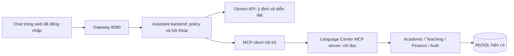

# C1 — Kiến trúc dự kiến

[Mục lục](README.md). Thiết kế cho C2–C7; chưa thêm service, route hay dependency.



## 1. Ranh giới triển khai

- Dự kiến một assistant-service cùng hệ backend Java hiện có, không nhúng key vào web và không sửa nghiệp vụ vào prompt. Chốt SDK/transport/dependency ở C3 sau khi kiểm tương thích Spring Boot thực tế; không thêm framework chỉ vì có ví dụ mẫu.
- Assistant là MCP host/client điều phối; MCP server thực sự có discovery/call theo protocol, có thể cùng gói triển khai bản đầu. Bộ function definitions gửi Gemini được ánh xạ từ schema MCP có whitelist, không gọi một wrapper REST là đã hoàn thành MCP.
- Ban đầu MCP chỉ nội bộ, không public qua ngrok và không cho client ngoài truy cập. Web chỉ gọi API assistant có xác thực. Không mở MCP cho Claude/Desktop/client ngoài trong C1–C7.
- Agent không truy cập MySQL trực tiếp. Công cụ đi qua API/lớp nghiệp vụ có kiểm quyền; endpoint, method và hostname cố định trong code/config do quản trị đặt, không từ prompt.
- Key Gemini chỉ trong backend; mặc định tắt assistant khi thiếu key/cấu hình. Không ảnh hưởng login/học vụ/tài chính nếu Gemini hết quota hoặc service assistant dừng.

## 2. Danh tính và ủy quyền

Assistant phải xác thực người dùng bằng Auth và dữ liệu phiên hiện hành; không tự phát JWT SUPER_ADMIN hoặc dùng một tài khoản quản trị chung gọi tất cả công cụ. Model không được thấy access token, key, cookie, auth header, API URL tùy ý hoặc schema database.

Ràng buộc ngữ cảnh gọi công cụ với accountId/profileId/role/scope đã xác minh tại server. MCP session ID không thay cho xác thực và không chứa bí mật. Trước mỗi lần thực thi, xác minh người gọi và quyền tài nguyên tại dịch vụ đích; direct tool call không được bypass policy.

Trong triển khai nội bộ, lớp integration dùng cơ chế gọi thay người dùng đã được dự án hỗ trợ và kiểm tra ở dịch vụ đích. Nếu có ranh giới HTTP MCP riêng, C3 phải thiết kế credential dành đúng audience và ủy quyền tới API downstream; không mặc định chuyển nguyên bearer token API thành token của MCP hoặc đưa token cho nhà cung cấp model. Chỉ nghiệm thu C3 khi có test identity propagation, logout/thu hồi phân công và từ chối caller sai. Chưa mở remote MCP ra bên ngoài nếu chưa có authorization phù hợp.

## 3. Hợp đồng phản hồi đề xuất

```json
{
  "requestId": "server-generated",
  "status": "ANSWER",
  "message": "Có 2 khóa học phù hợp trong chi nhánh đang xem.",
  "scope": {"mode": "ACTIVE_BRANCH", "branchId": 1, "label": "Chi nhánh 1"},
  "observedAt": "2026-11-13T10:30:00+07:00",
  "cards": [],
  "sources": [{"tool": "search_courses", "resourceType": "course"}],
  "warnings": [],
  "nextPage": null
}
```

Ví dụ trên là hợp đồng dự kiến với dữ liệu giả lập. Status còn có CLARIFICATION_REQUIRED, OUT_OF_SCOPE, UNSUPPORTED_CAPABILITY, UNSUPPORTED_ACTION, FORBIDDEN, NO_RESULTS, DEPENDENCY_UNAVAILABLE, RATE_LIMITED. HTTP auth lỗi vẫn dùng 401/403; không bọc mọi lỗi thành 200 ANSWER. Không đưa exception/stacktrace hay URL nội bộ vào chat.

Server quyết định scope, sources, cards và link; model chỉ hỗ trợ diễn đạt trên payload đã cắt trường. Các số tiền/count/trạng thái trong card và tóm tắt phải khớp dữ liệu công cụ; nếu không chứng minh được thì dùng câu trả lời template an toàn. Không render HTML model trực tiếp. Chỉ link relative đã whitelist và đúng tài nguyên/role; chưa có link phù hợp thì hiển thị văn bản, không bịa query.

Tìm kiếm trả items, totalElements, page/size và hasMore; không nói “chỉ có 5” khi total là 50. observedAt là lúc truy vấn quan sát được, không phải thời gian sửa từng bản ghi. Tổng hợp nhiều nguồn ghi thời điểm riêng nếu khác; nguồn lỗi không làm nguồn thành công biến mất hoặc được coi là 0.

## 4. Hội thoại và chủ đề

Giữ trong phiên, không thêm bảng lưu chat dài hạn. Transcript từ trình duyệt là input không tin cậy; không nhận role=system/tool từ client. Câu trả lời lượt trước không phải bằng chứng cấp quyền hoặc dữ liệu hiện hành. Tham chiếu “người thứ hai”, “lớp đó”, “còn chi nhánh kia” chỉ dùng các ID đã được server ràng buộc trong hội thoại đúng user/scope, rồi kiểm lại trước truy vấn.

C4 phải có allowlist ý định/công cụ từ đầu. C5 mở rộng bộ kiểm soát: câu hỏi hỗn hợp, giả mạo role, prompt injection trong nội dung chat và trong tên/ghi chú tài nguyên. Không chỉ chặn keyword; không có nhánh chat tự do khi không xác định được ý định. Hỏi lại nếu ý định/tài nguyên/scope chưa rõ. Nội dung nghiệp vụ trong database không trở thành chỉ dẫn thực thi.

## 5. Giới hạn bản đầu, sẽ đo tại C7

Đề xuất mặc định: câu hỏi tối đa 2.000 ký tự, tối đa 10 lượt gần nhất trong ngữ cảnh, tối đa 4 lần gọi tool và 3 lượt gọi model mỗi request, page size tối đa 20, truy vấn lịch tối đa 31 ngày, timeout tổng 30 giây. Đây là hạn mức ứng dụng dự kiến, không phải quota Gemini. Phải cấu hình được và kiểm tra số liệu thực tế trước chốt.

Rate limit theo người dùng và tổng service; retry giới hạn cho lỗi tạm thời, không lặp vô hạn khi 429. Không tự bật billing, không tự đổi model/provider hoặc fallback sang model ngoài cấu hình. Gateway hiện có response timeout 15 giây: C4 phải quyết định streaming hoặc timeout route riêng có giới hạn trước khi dùng request 30 giây; không chỉ tăng timeout toàn gateway.

Log mặc định: requestId, user tham chiếu nội bộ, intent, tool, scope, duration, số token nếu có, mã lỗi. Không log key/JWT, prompt đầy đủ hoặc kết quả PII. Phân quyền nhật ký và thời gian giữ cấu hình được. Chỉ test bằng fixture và dữ liệu tổng hợp khi gọi Gemini free tier; dữ liệu vận hành thật cần một quyết định riêng về nhà cung cấp/chính sách dữ liệu trước khi bật.

## 6. Phụ thuộc C2–C7

C2 không cần gọi model; C3 kiểm bằng MCP client/test harness; C4 dùng model adapter giả lập rồi mới thử key trên dữ liệu tổng hợp; C5 là điều kiện mở UI ở C6; C7 tách kết quả fixture, API thật và Gemini thật. Nếu chưa kiểm được quota/key hoặc thiết bị, ghi rõ chưa nghiệm thu, không coi build thành công là đã hoạt động.
