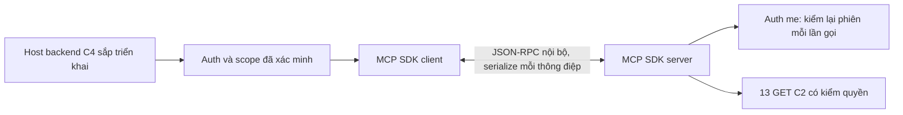

# C3 — MCP server chỉ đọc

Cập nhật 13/11/2026. Đã thêm module `assistant-service`, SDK MCP Java 2.0.0, Java 21, Spring Boot 4.1.1 và Jackson 3. Đã kiểm discovery/call bằng SDK client/server thật và đóng gói JAR. Tiếp nối [C2](c2-completion.md); chưa gọi Gemini, chưa có endpoint chat hoặc drawer web.

## 1. Kiến trúc đã triển khai



MCP có initialize, capability negotiation, tools/list và tools/call thực sự; không gọi một wrapper REST là MCP. Dùng transport riêng trong cùng JVM cho cặp client/server một-một. Transport serialize/deserialize JSON-RPC qua API SDK, không truyền tham chiếu object nghiệp vụ trực tiếp. Bản này dùng API client/server classic của SDK, không dùng nhánh modern preview.

Đây là quyết định triển khai nội bộ theo C1: chưa có URL MCP HTTP/SSE/stdio cho client ngoài, không đưa bearer token API qua một endpoint MCP từ xa. Credential và scope được host giữ ngoài thông điệp MCP; closure của từng connection nhận đúng caller. Chưa hỗ trợ Inspector/Desktop/client ngoài; nếu bổ sung transport mạng phải thiết kế authorization/audience riêng, không bật bằng cách expose service hiện tại.

Module có HTTP `127.0.0.1:8086` để vận hành và chuẩn bị C4, nhưng hiện chỉ public `/actuator/health`; mọi URL khác bị từ chối, kể cả người dùng HTTP có role SUPER_ADMIN. Gateway chưa có route assistant. Health UP chỉ xác nhận tiến trình hoạt động, không khẳng định Auth/Gemini hay nghiệp vụ đã sẵn sàng.

Nguồn chính thức đã đối chiếu khi triển khai: [Java SDK 2.0.0](https://github.com/modelcontextprotocol/java-sdk/tree/v2.0.0), [server API](https://github.com/modelcontextprotocol/java-sdk/blob/v2.0.0/docs/server.md), [giao diện transport tùy chỉnh](https://github.com/modelcontextprotocol/java-sdk/blob/v2.0.0/mcp-core/src/main/java/io/modelcontextprotocol/spec/McpTransport.java).

## 2. Công cụ và schema

Danh mục máy đọc được, xuất từ SDK qua kiểm thử: [mcp-tool-catalog.json](mcp-tool-catalog.json). Có 12 công cụ cho SA/A/S, 8 cho T; schema điểm khác nhau theo role.

| Tool | SA/A | STAFF | TEACHER |
|---|---|---|---|
| search_courses | Có | Có | Có |
| search_classes | Theo scope | Theo scope | Lớp chính mình |
| find_students | Theo scope | Theo scope | Roster lớp chính mình |
| get_student_classes | Theo scope | Theo scope | Chỉ lớp chính mình |
| get_student_statistics | Có | Chi nhánh hiện tại | Không |
| list_sessions | Theo scope | Theo scope | Actual teacher |
| get_session_attendance | Theo quyền buổi | Theo quyền buổi | Actual/primary có quyền đọc buổi |
| get_learning_results | CURRENT hoặc PUBLISHED | Chỉ PUBLISHED | Chỉ CURRENT của lớp chính mình |
| search_tuitions | Có | Có | Không |
| search_receipts | Có | Có | Không |
| list_priority_leads | Có | Chỉ lead được giao | Không |
| get_usage_help | Có | Có | Có |

`get_learning_results` ánh xạ hai GET C2: CURRENT bắt buộc examId; PUBLISHED bắt buộc studentId/enrollmentId. Không trộn hai bộ tham số. Mặc định T dùng CURRENT; SA/A/S dùng PUBLISHED. Nếu chưa xác định đủ ID, C4 phải làm rõ/tra cứu trước; không tự đoán ID hoặc truy vấn ngoài các công cụ đã có.

Schema có `additionalProperties=false`, danh sách enum hữu hạn, kiểu số/bool/date rõ ràng, ID dương, keyword tối đa 120 ký tự, size 1–20, page tối đa 1.000.000. Tiền không âm, tối đa 13 chữ số nguyên/2 số lẻ. SDK bật kiểm tra schema; handler vẫn kiểm tra và chuẩn hóa tham số. Mọi công cụ có readOnlyHint=true, destructiveHint=false, openWorldHint=false; annotation không thay cho phân quyền.

Không có argument role, accountId, branchId, scopeMode, bearer, token, SQL, URL hoặc HTTP method. Không có mutation, file system, shell, web search, sampling, arbitrary resources hay prompt đọc file. Tham số phạm vi chỉ do host truyền vào khi mở connection, được Auth kiểm chứng, không cho model ghi đè qua arguments hoặc metadata.

## 3. Xác thực và ủy quyền

- Mở connection phải gọi `/api/v1/auth/me` với bearer hiện tại. Không tự ký JWT, không dùng tài khoản quản trị chung, không cần JWT_SECRET trong module mới.
- Kiểm accountId/profileId, role, status, mustChangePassword, chi nhánh chính và tập phân công. STUDENT/role lạ, khóa tài khoản, bắt đổi mật khẩu hoặc scope không hợp lệ đều bị từ chối.
- Mỗi lần thực thi tool gọi Auth lại. Nếu danh tính/role/profile/phân công thay đổi so với lúc mở, trả SESSION_CHANGED hoặc lỗi phiên tương ứng; host phải mở ngữ cảnh mới. Logout/thu hồi phiên bị chặn trước truy vấn nghiệp vụ.
- Danh mục discovery lọc theo role, nhưng không chỉ dựa vào ẩn tool: direct SDK tool call vẫn qua kiểm quyền, schema và kiểm API C2. C2 tiếp tục xác minh phiên/quyền tài nguyên độc lập; giáo viên dạy thay không có quyền điểm cả lớp.
- Scope mặc định ACTIVE_BRANCH; ALL_ASSIGNED chỉ ADMIN, WHOLE_SYSTEM chỉ SUPER_ADMIN; không kết hợp branchId với tổng hợp. Host phải chọn scope rõ theo chính sách C1. Credential/phạm vi mỗi connection độc lập, không dựa ThreadLocal xuyên worker MCP.
- Downstream chỉ GET tới origin trong config và prefix C2 cố định; không theo redirect. Chỉ header API downstream nhận bearer và chi nhánh đã xác minh. Không ghi credential vào schema, MCP arguments/result, transcript hoặc log.

## 4. Giới hạn và phản hồi

- Mặc định tắt MCP; tối đa 16 connection cùng lúc, TTL 120 giây, 8 lượt thực thi handler/connection. Hạn mức này bảo vệ runtime, không thay rate limit người dùng và giới hạn 4 tool call/request của C4–C5.
- Connection đóng trong try-with-resources; có reaper mỗi 10 giây để thu hồi connection hết TTL. Shutdown đóng connection đang giữ. Lượt gọi tiếp sau close/expiry bị từ chối.
- HTTP connect timeout 3 giây; deadline mỗi request Auth/C2 6 giây, bao gồm body; MCP request timeout 20 giây. Không retry lỗi, không fallback provider/model và không bật billing.
- Body downstream giới hạn 256 KiB trước parse; transport giới hạn request JSON-RPC 65.536 ký tự và response 1.048.576 ký tự. Chưa benchmark throughput production.
- Thành công có structuredContent và text JSON cùng payload C2. Kiểm source, scope và các trường envelope trước khi trả. Không trả body lỗi downstream, stacktrace hoặc credential.
- Lỗi tool dùng isError=true và mã an toàn như UNAUTHENTICATED, FORBIDDEN, SESSION_CHANGED, INVALID_ARGUMENTS, DEPENDENCY_UNAVAILABLE, RATE_LIMITED, RESULT_TOO_LARGE. Tool lạ/lỗi protocol đi qua facade trả INVALID_TOOL_CALL. NO_RESULTS hợp lệ giữ từ C2; lỗi không biến thành số 0.
- Tắt log SDK và log body HTTP trong cấu hình mặc định vì dữ liệu nghiệp vụ có thể chứa tên học viên. Không bật debug payload trên dữ liệu thật.

## 5. Cách chạy

Từ backend gốc:

```powershell
cd assistant-service
mvn verify
mvn spring-boot:run
```

Hoặc từ backend gốc:

```powershell
.\scripts\run-service.ps1 -Service assistant-service
```

Đã bổ sung Maven wrapper, module root POM và runner. Runner không đòi DB_PASSWORD/JWT_SECRET cho assistant-service; module không có JPA/MySQL dependency.

`.env.example` đã có:

```dotenv
ASSISTANT_MCP_ENABLED=false
ASSISTANT_PORT=8086
```

Không sửa `.env.local` của người dùng. Khi C4 cần mở connection thật, bật ASSISTANT_MCP_ENABLED=true trong môi trường backend. AUTH_URL/ACADEMIC_URL/FINANCE_URL/TEACHING_URL tái sử dụng cấu hình hiện hành. Không cần GEMINI_API_KEY cho C3; bật MCP chưa làm xuất hiện chatbot hoặc endpoint public.

Kiểm tra JAR riêng trên Windows, sau khi build:

```powershell
.\scripts\assistant\smoke-local.ps1
```

Script mở tiến trình ẩn trên loopback/cổng ngẫu nhiên, không import `.env.local`, MCP tắt; kiểm health UP và POST /mcp trả 401, rồi dừng đúng PID/command line do script tạo. Không dừng service của người dùng. Kết quả local ở `storage/c3-smoke/result.json`.

## 6. Điểm tích hợp C4

Host backend sẽ gọi bean AssistantMcpRuntime bằng thông tin từ request đã xác thực; không đưa đoạn này vào client/model:

```java
try (var connection = runtime.open(bearerFromRequest, SessionVerifier.Mode.ACTIVE_BRANCH, selectedBranch)) {
  var tools = connection.tools();
  var result = connection.call("search_courses", Map.of("maxTuition", 5000000, "maxInclusive", false));
}
```

C4 ánh xạ schema discovery sang function calling Gemini và đưa lời gọi công cụ quay về connection.call; không tạo một đường gọi C2 thứ hai bỏ qua MCP/policy. C4–C5 còn phải kiểm chủ đề, ngữ cảnh hội thoại, xác nhận trùng tên, lựa chọn scope rõ, rate limit và kết quả diễn đạt. Không cho web gọi Java host seam hoặc SDK client trực tiếp.

## 7. Kiểm thử đã chạy

`mvn verify` đạt **24 test**, 0 lỗi/thất bại/bỏ qua: 20 MCP runtime và 4 Spring/HTTP security. JAR repackaged thành công. Các ca dùng SDK thật, Auth và API C2 giả lập qua HTTP loopback riêng; không phải kết nối Auth/MySQL thật.

Đã kiểm initialize/list/call, schema và đủ 12 ánh xạ GET; T chỉ discovery 8 tool; direct SDK calls bị chặn; input lạ/SQL/URL/mutation; auth sai/logout/khóa/đổi mật khẩu/thu hồi phân công/đổi role; hai người dùng gọi đồng thời đúng token và chi nhánh riêng; CURRENT/PUBLISHED; scope/source mismatch; HTTP lỗi/redirect; TTL/capacity/budget/close; body quá lớn và body chậm sau headers. Snapshot schema xuất theo bốn role không có credentials.

JAR smoke cuối đạt health UP và HTTP MCP 401; tiến trình đã được dừng. Đã kiểm cú pháp PowerShell runner/smoke và root Maven nhận module mới. Bằng chứng local: `storage/c3-verify.log`, `assistant-service/target/surefire-reports`, `storage/c3-smoke/result.json`, `storage/c3-verification.json`.

Không đổi API nghiệp vụ C2, schema database, web/mobile hoặc cấu hình ngrok/VNPAY. Số API nghiệp vụ vẫn 251; không tính tool MCP thành REST endpoint. Không chạy lại 470 test C2 vì source nghiệp vụ không đổi ở C3. Chưa gọi Gemini hoặc chạy end-to-end trên dữ liệu thật; bộ 50 câu hỏi hội thoại C1 vẫn chờ C4–C7.

C3 hoàn thành phần source, protocol và kiểm thử nội bộ. Bước tiếp theo là C4 — backend trợ lý Gemini; chưa tự triển khai C4 trong lượt này.
