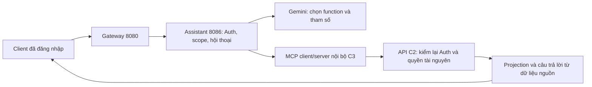

# C4 — Backend hội thoại Gemini + MCP

Cập nhật 13/11/2026. Đã triển khai backend, API và kiểm thử C4. **Chưa nghiệm thu hội thoại với Gemini thật**: smoke dùng dữ liệu tổng hợp kết thúc bằng `MODEL_TIMEOUT`; phép thử generateContent độc lập trả HTTP 503. Không kết luận key sai hoặc hết quota từ những kết quả này. UI web thuộc C6; điều kiện mở UI là hoàn thành kiểm soát C5.

**Cập nhật sau C4:** [C5 đã bổ sung kiểm soát và hạn mức](c5-completion.md), gồm body chunked, rate limit theo account, audit và kiểm thu hồi trước trả dữ liệu. Nội dung/số test bên dưới giữ theo mốc C4; xem C5 cho hành vi hiện tại.

## Phần đã triển khai



- Gemini nhận schema từ MCP discovery và chọn công cụ trong danh sách phù hợp chủ đề/quyền. Không có SQL tự do, truy cập DB trực tiếp hoặc công cụ HTTP tùy ý.
- Model chỉ đưa function call hoặc quyết định hữu hạn qua `assistant_decision`. Message, card, số lượng, nguồn và liên kết được backend tạo từ kết quả API; không chuyển văn bản tự do của model đến người dùng.
- Dùng REST generateContent; giữ nguyên model content, function-call ID và thought signature trong vòng gọi tool của cùng request. Không đưa bearer/API key vào prompt, MCP message hoặc response. Không lưu thought signature vào lịch sử hội thoại.
- Auth lấy trực tiếp `/api/v1/auth/me`; không tin role/account/branch do client khai báo. C3 kiểm lại phiên trước mỗi công cụ; downstream tiếp tục kiểm quyền tài nguyên. Không dùng tài khoản quản trị chung.
- Trùng tên học viên/lớp/buổi học trả `CLARIFICATION_REQUIRED` với tối đa 5 lựa chọn. Chọn theo `selection` hoặc “người thứ hai”; ID phải thuộc danh sách server đã trả, và bản ghi được truy vấn lại. ID phụ thuộc phải có bằng chứng từ công cụ hoặc được người dùng ghi rõ, ví dụ `#11`.
- “Top khách hàng tiềm năng” được hỏi lại trước khi chuyển sang danh sách **ưu tiên chăm sóc theo lịch hẹn**; không giả lập điểm dự đoán đăng ký.
- “Xem tiếp trang sau” dùng lại bộ lọc phía server và truy vấn dữ liệu mới. Lỗi phụ thuộc không bị biến thành số 0. STAFF không xem điểm chưa công bố; TEACHER không có thống kê toàn trung tâm, học phí, phiếu thu hoặc lead.
- Projection loại liên hệ/ghi chú/mô tả tự do không cần thiết; cắt danh sách tối đa 20 phần tử, chuỗi 500 ký tự và kiểm liên kết relative theo route/role. Quyền mở tài nguyên vẫn do trang/API đích kiểm lại.

## API đã có

Mọi route cần bearer của SA/A/S/T. STUDENT không dùng chatbot web này. Gateway thêm route assistant riêng, timeout 40.000 ms; các route cũ giữ timeout hiện có.

| Method | Route | Kết quả |
|---|---|---|
| GET | `/api/v1/assistant/config` | enabled, readOnly, role, maxMessageLength, conversationTtlMinutes, selectionTypes; không trả bí mật |
| POST | `/api/v1/assistant/chat` | Một lượt hội thoại, kết quả có cấu trúc |
| DELETE | `/api/v1/assistant/conversations/{id}` | 204 khi xóa hội thoại của đúng phiên; 404 với hội thoại khác |

Ví dụ body lượt đầu, dữ liệu minh họa:

```json
{
  "message": "Thông tin khóa học giao tiếp dưới 5 triệu",
  "requestId": "849b9d40-4ecf-438a-ad7a-016e233b8388",
  "scopeMode": "ACTIVE_BRANCH"
}
```

Gửi `X-Branch-Id` để chọn chi nhánh; thiếu header dùng chi nhánh chính. Các mode thực tế: `ACTIVE_BRANCH`, `ALL_ASSIGNED` (ADMIN), `WHOLE_SYSTEM` (SUPER_ADMIN); xem quyền scope ở [C3](c3-completion.md). Muốn toàn hệ thống phải chọn rõ `WHOLE_SYSTEM`. Đổi scope cần mở hội thoại mới.

Lượt tiếp theo gửi `conversationId` đã nhận và requestId mới. Lựa chọn minh họa:

```json
{
  "message": "Chọn học viên này",
  "conversationId": "3a9486b3-7e83-43c1-bb04-20cd41c1c289",
  "requestId": "b0901b9e-321d-47fd-aacd-de4c0a6df246",
  "selection": {"type": "STUDENT", "id": 11}
}
```

Chỉ dùng ID/type từ `choices` thực tế. `message` luôn bắt buộc, tối đa 2.000 ký tự; không nhận transcript, system prompt, role hay URL từ client. Trường JSON lạ, sai kiểu hoặc ID không nguyên bị từ chối.

Response có `requestId`, `conversationId`, `status`, `message`, `scope`, `observedAt`, `cards`, `choices`, `sources`, `warnings`, `hasMore`, `nextPage`. Card chứa `tool/title/data`; source chứa `tool/observedAt/scope`. Mốc quan sát không phải thời điểm cập nhật từng bản ghi. Các trạng thái hội thoại gồm `ANSWER`, `NO_RESULTS`, `CLARIFICATION_REQUIRED`, `OUT_OF_SCOPE`, `UNSUPPORTED_CAPABILITY`, `UNSUPPORTED_ACTION`.

Lỗi HTTP có `{code,message}` an toàn: 400 input/selection, 401 phiên không hợp lệ, 403 quyền, 404 hội thoại, 409 scope/phiên đổi hoặc requestId xung đột, 413 body quá lớn có Content-Length, 429 quota/công suất, 503 cấu hình/phụ thuộc/model không sẵn sàng, 504 timeout. Không trả body lỗi nhà cung cấp hoặc stacktrace.

## Hội thoại và hạn mức

- Chỉ RAM, tối đa 200 hội thoại; hết hạn sau 15 phút không hoạt động, dọn định kỳ. Restart mất hội thoại. Chưa dùng chung giữa nhiều instance.
- Owner là SHA-256 của account + bearer, không lưu bearer trong conversation. Binding gồm danh tính/phân công và scope hiện hành; phiên hoặc scope đổi không được đọc lại câu trả lời cũ.
- Giữ tối đa 10 câu hỏi/trạng thái gần nhất và 8 response để replay theo requestId. Replay cùng requestId/nội dung không gọi lại Gemini; dữ liệu là snapshot với observedAt cũ. Cần requestId mới để làm mới. Không dùng câu trả lời trước làm bằng chứng cấp quyền.
- Tối đa 8 request chat đồng thời, 3 lượt model và 4 lượt tool/request. Tổng deadline 30 giây tính từ Auth filter, gọi model mặc định 20 giây/lần trong thời gian còn lại. `GEMINI_TIMEOUT_SECONDS` giới hạn trong 1–25. Truy vấn lịch tối đa 31 ngày theo schema C3.
- Không tự retry 429, đổi model/provider hoặc bật billing. Các giới hạn này là hạn mức ứng dụng, không phải quota Google.

## Cấu hình và cách chạy

Giữ mặc định tắt trong `.env.example`. Khi kiểm thử tích hợp đã sẵn sàng, đặt trong `.env.local` **ở backend gốc**:

```dotenv
ASSISTANT_MCP_ENABLED=true
ASSISTANT_CHAT_ENABLED=true
ASSISTANT_PORT=8086
ASSISTANT_URL=http://localhost:8086
GEMINI_API_KEY=YOUR_KEY
GEMINI_MODEL=gemini-3.8-flash
GEMINI_TIMEOUT_SECONDS=20
```

Model phải đúng model dự án Google có quyền sử dụng; giá trị trên khớp cấu hình hiện tại, không phải cam kết khả dụng/quota. Không chỉnh `.env.local` hoặc tự bật hai cờ trong C4. `config.enabled` chỉ true khi chat, MCP và key đều được cấu hình; không phải health check inference. AUTH_URL/ACADEMIC_URL/TEACHING_URL/FINANCE_URL tái sử dụng cấu hình C3.

Khởi động Auth, academic, teaching, finance, sau đó từ backend gốc:

```powershell
.\scripts\run-service.ps1 -Service assistant-service
```

Hoặc trong `assistant-service`: `mvn spring-boot:run`. Khởi động lại gateway để nạp route mới. Assistant mặc định bind `127.0.0.1:8086`, không có endpoint MCP công khai. Không cần migration/database mới cho C4. Chưa mở cho dữ liệu vận hành thật trước khi thống nhất chính sách gửi dữ liệu cho nhà cung cấp và hoàn thành C5/C7.

## Kiểm chứng và giới hạn bàn giao

| Kiểm tra | Kết quả |
|---|---|
| Assistant `mvn verify`, C3 + C4 | 62 ca: 61 đạt, 1 smoke Gemini opt-in bị bỏ qua trong bộ mặc định |
| Gateway | 9 ca đạt; kiểm 5 prefix và timeout riêng assistant |
| JAR smoke | Đạt: health UP, POST /mcp không token bị chặn 401; `storage/c3-smoke/result.json` |
| Kiểm kê controller | 254 API chính, 259 gồm alias/chẩn đoán; assistant thêm 3 |
| Gemini thật + MCP + Auth/C2 tổng hợp | **Chưa đạt**: `MODEL_TIMEOUT`; kiểm tra generateContent độc lập HTTP 503 |

Log local: `storage/c4-verify.log`, `storage/c4-gateway-tests.log`; kết quả live an toàn: `assistant-service/target/c4-gemini-live.json`. Maven verify không gọi Gemini hoặc MySQL thật. Các test gồm trùng tên/chọn lại, giả ID/tool, nguồn có giá trị 0, quyền teacher/staff, đổi scope/phiên/phân công, replay/xung đột, quota/timeout, giới hạn body provider, schema và giữ signature. Không tuyên bố bộ nghiệm thu C1 hoặc hệ thống thật đã PASS.

```powershell
.\scripts\assistant\smoke-local.ps1
# Chỉ chạy khi muốn thử lại Gemini; một truy vấn dữ liệu tổng hợp, có thể tính quota API:
.\scripts\assistant\gemini-live-smoke.ps1
```

Smoke JAR dùng cổng ngẫu nhiên, không import env và tự dừng process do script tạo. Đã sửa cleanup để không phụ thuộc quyền CIM trên Windows. Không dừng service người dùng.

**Tiếp theo C5:** mở rộng kiểm chủ đề hỗn hợp/prompt injection trong chat và dữ liệu; hardening body chunked, rate limit theo account, audit không lộ nội dung, kiểm bộ nghiệm thu đối kháng. C4 mới có lớp chặn ban đầu, chưa cam kết chặn mọi câu hỏi ngoài chủ đề. C6 xây drawer web; C7 nghiệm thu Gemini + API thật và vận hành.

Đối chiếu giao thức: [Gemini generateContent / parametersJsonSchema](https://ai.google.dev/api/generate-content?hl=en), [thought signatures](https://ai.google.dev/gemini-api/docs/generate-content/thought-signatures), [Gateway timeout theo route](https://docs.spring.io/spring-cloud-gateway/reference/spring-cloud-gateway-server-webflux/http-timeouts-configuration.html).
