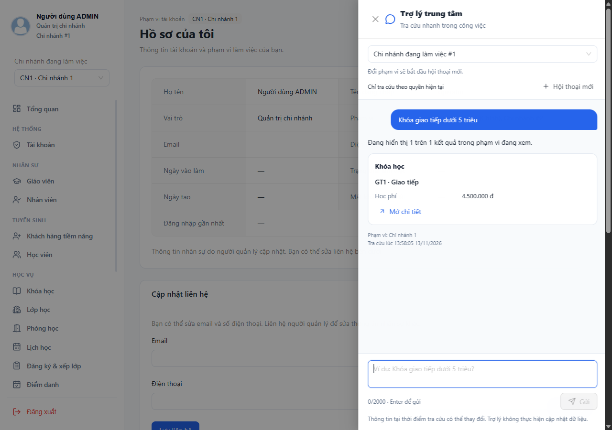
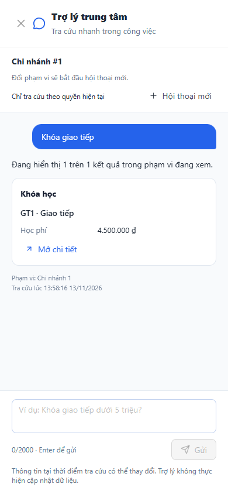

# C6 — Giao diện trợ lý trên web quản lý

Cập nhật 13/11/2026. Đã triển khai UI C6 trong `language-center-web-frontend`, theo cấu trúc types/services/utils/components hiện có. Dùng Ant Design + styled-components, không thêm thư viện chat, không thay trang nghiệp vụ hoặc giao diện mobile student.

Sau bàn giao C6 đã [sửa lỗi phân loại config 404 và cấu hình chạy local](troubleshooting.md); frontend hiện 120 test và 21 luồng browser đạt. Các số 119/20 dưới đây giữ theo mốc bàn giao C6 ban đầu.

## Giao diện và cách sử dụng

- Sau đăng nhập, bốn role SUPER_ADMIN/ADMIN/STAFF/TEACHER có nút **Trợ lý** ở góc dưới bên phải. Không hiển thị ở trang đăng nhập hoặc khi bắt buộc đổi mật khẩu.
- Drawer mở bên phải trên desktop, chiếm chiều rộng màn hình trên mobile. Có ô nhập, câu hỏi gợi ý theo role, trạng thái đang tra cứu, kết quả dạng card và thời điểm/phạm vi quan sát.
- Nhấn Enter gửi, Shift+Enter xuống dòng, Escape trong ô nhập đóng drawer. Có nhãn truy cập cho control, vùng hội thoại live và nút Dừng chờ.
- Nhập tối đa 2.000 ký tự. Có thể nhập câu tiếp trong lúc chờ, nhưng không gửi đồng thời hoặc đổi phạm vi trong cùng lượt.
- Các nút gợi ý của giáo viên tập trung lịch dạy/học viên trong lớp/hướng dẫn; không gợi ý thống kê toàn trung tâm, tài chính hoặc lead.
- Card có học phí, quan hệ lớp, lịch, điểm danh, điểm, công nợ, phiếu thu và khách hàng ưu tiên theo payload được backend cho phép. Tiền định dạng VND, ngày/giờ UTC+7, phân biệt điểm 0 với chưa chấm, điểm danh chưa ghi nhận với có mặt. Không dump JSON hoặc render HTML/Markdown từ model.

## Phạm vi và điều hướng

| Role | Phạm vi chat |
|---|---|
| SUPER_ADMIN | Mặc định Toàn hệ thống; có thể chọn Một chi nhánh rồi chọn rõ chi nhánh hoạt động |
| ADMIN | Chi nhánh đang làm việc hoặc các chi nhánh đang được phân công |
| STAFF/TEACHER | Chi nhánh đang làm việc; backend tiếp tục kiểm quyền tài nguyên |

Đổi mode/chi nhánh mở ngữ cảnh mới, xóa lịch sử cũ khỏi UI và abort lời gọi cũ. Danh tính, token, role, chi nhánh làm việc và tập phân công là ranh giới của phiên UI. Lịch sử không lưu vào localStorage/sessionStorage; token và lựa chọn chi nhánh vẫn do cơ chế Auth sẵn có quản lý.

Trùng tên trả nút chọn mã/tên/chi nhánh do server cấp; UI gửi selection type/id, conversationId và requestId. Chỉ lựa chọn/phân trang ở câu trả lời mới nhất còn hoạt động. “Xem thêm kết quả” giữ conversation và bộ lọc do backend quản lý.

Mở chi tiết dùng allowlist route/query theo **quyền trang web thực tế**, không suy từ quyền đọc MCP. Ví dụ giáo viên xem card khóa học nhưng không được dẫn vào `/courses`, STAFF không vào `/grades`. Link ngoài domain, redirect, query lặp, ký tự ẩn, ID sai hoặc chi nhánh ngoài phân công bị loại.

Admin mở kết quả khác chi nhánh sẽ thấy xác nhận chuyển chi nhánh trước khi điều hướng; nút mở giữ branchId. Với kết quả đa chi nhánh không xác định được chi nhánh đích, UI giữ card và không tạo link phỏng đoán. Quyền cuối cùng vẫn do API/trang đích kiểm lại.

## Hội thoại, lỗi và trạng thái bất đồng bộ

- Giữ tối đa 40 lượt ở RAM tab hiện tại. Chuyển trang trong cùng ngữ cảnh giữ hội thoại; đóng drawer giữ các kết quả đã nhận, dừng chờ request hiện tại.
- Dừng chờ/đóng tab request không bảo đảm server chưa thực thi; UI không thông báo đã hủy nghiệp vụ. Thử lại giữ nguyên requestId/body để tận dụng replay C4; không tự tạo lượt model mới khi người dùng bấm thử lại cùng yêu cầu.
- Khi đổi tài khoản, token, scope hoặc phân công, component cũ bị tháo và request bị abort; response cũ không được thêm vào ngữ cảnh mới. Trước khi áp dụng response còn kiểm token, requestId và scope.
- 401 dùng cơ chế hết phiên sẵn có; 403 hiển thị thiếu quyền; 404/409 context đổi thì xóa ngữ cảnh cũ và yêu cầu mở hội thoại mới. CONVERSATION_BUSY được báo riêng, có thể thử lại.
- 429 đọc Retry-After, giới hạn thời gian chờ UI 1–300 giây (mặc định 60), khóa gửi/gợi ý/lựa chọn và không tự retry. Nút kiểm tra config cũng không cho bấm liên tục trong thời gian chờ quota.
- 503/504/mạng lỗi dùng thông báo người dùng và nút thử lại; không in code kỹ thuật, exception, provider body hoặc key. Config tắt/dịch vụ chưa chạy có trạng thái “Trợ lý hiện chưa sẵn sàng”, các trang khác vẫn sử dụng được.
- Hội thoại mới gọi DELETE cho conversation hiện tại. Nếu chưa xóa được trên server, UI nói rõ đã mở hội thoại mới và lịch sử trước sẽ tự hết hạn; không giả báo xóa thành công.
- Chat request timeout 35 giây, phù hợp deadline backend 30 giây và route gateway 40 giây. Config/delete timeout 8 giây. Giữ timeout 15 giây của API client chung cho các trang khác.

## Hai chỉnh sửa backend đi kèm C6

1. ReplyFormatter cho phép query `branchId` trên link `/courses`, đúng link do Academic C2 tạo. Trước đó whitelist C5 loại mất link hợp lệ này. ID/query khác vẫn bị kiểm chặt, có test hồi quy.
2. Gateway expose thêm header `Retry-After` cho trình duyệt. Không mở rộng origin, method hoặc quyền API; có test origin được phép/ngoài allowlist.

Không thêm endpoint, migration hoặc tool. Tổng số API vẫn 254 chính. Không sửa `.env.local`, không tự bật hai cờ assistant hoặc đổi provider/model.

## Kiểm chứng

| Kiểm tra | Kết quả |
|---|---|
| Web `npm test` | 119 đạt, gồm 10 test C6 mới |
| Web `npm run build` | Đạt, lazy-load assistant; Vite còn cảnh báo chunk styled-components >500 kB |
| ESLint các file C6 và App | Đạt |
| Assistant | 123 đạt, 1 Gemini live opt-in skip |
| Gateway | 10 đạt, gồm test expose Retry-After và giữ origin allowlist |
| Package assistant/gateway | Đạt, dùng đúng source đã kiểm thử |
| Chromium với bản build web và API tổng hợp | 20 luồng: bốn role, keyboard, tiền/0/null, choice/page/replay, 429, XSS/link, scope/branch, SPA session change, mobile, xóa hội thoại, unavailable và logout |

Log/kết quả local: `storage/c6-web-tests.log`, `storage/c6-web-build.log`, `storage/c6-web-lint.log`, `storage/c6-backend-tests.log`, `storage/c6-backend-package.log`, `storage/c6-ui/result.json`. Browser chạy bằng [script C6](../../scripts/assistant/c6-browser.mjs), dùng Chrome profile và cổng riêng; intercept API bằng fixture, không gọi dữ liệu hoặc database thật. Không dùng backend thật trong browser test, không suy từ build là full-stack đã hoạt động.

## Chạy bản cập nhật

1. Build/restart **assistant-service** và **api-gateway** để nhận link/CORS mới. Cách khởi động và biến backend ở [C4](c4-completion.md), hạn mức ở [C5](c5-completion.md).
2. Trong `language-center-web-frontend`, chạy `npm run dev` hoặc triển khai thư mục `dist` đã build. Không đưa GEMINI_API_KEY vào biến VITE hoặc frontend.
3. Đăng nhập một trong bốn role, bấm Trợ lý. Để tra cứu thật, backend phải có `ASSISTANT_MCP_ENABLED=true`, `ASSISTANT_CHAT_ENABLED=true`, key/model hợp lệ và Auth/Academic/Teaching/Finance đang chạy. C6 không tự bật các biến này.
4. Khi Gemini chưa sẵn sàng, UI báo trạng thái tương ứng; không tự chuyển provider hoặc bịa câu trả lời.

**Còn C7:** ở mốc C6 chưa nghiệm thu model thật do timeout/HTTP 503. Sau C6 đã đổi model theo lựa chọn người dùng và kiểm đạt bốn luồng Gemini + MCP thật với API tổng hợp; [bằng chứng và cấu hình mới](troubleshooting.md). C7 còn nghiệm thu API nghiệp vụ/MySQL thật, bộ câu hỏi C1, độ chính xác, latency/quota và chính sách dữ liệu. Chưa tuyên bố toàn bộ chatbot đã sẵn sàng production.
