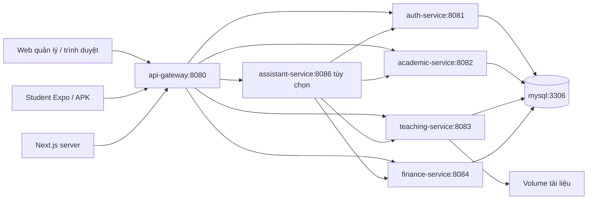

# Docker — DCK1–DCK6

**Docker DCK6 (25/11/2026):** hoàn tất bộ lệnh vận hành, backup/restore DB + tài liệu, thử cập nhật/rollback hai image web và restart toàn stack. 9 container healthy; Docker hiện có 419 tài khoản, 400 học viên, 20 khóa, 40 lớp. Kiểm tra đạt: 13 backup/restore, 8 lifecycle, 23 chức năng/phân quyền và 38 HTTP/web. [Hướng dẫn và lệnh dùng hằng ngày](dck6-handoff.md).

**DCK5 hoàn thành:** Dữ liệu từ MySQL local (87 bảng, 8.886 bản ghi) đã được chuyển nhất quán vào volume Docker MySQL riêng; 9 container healthy; nghiệm thu 17/17 tiêu chí phân quyền RBAC và tích hợp web đạt 100%. Web quản lý http://localhost:15173, website http://localhost:13000, Gateway http://localhost:18080. [Bàn giao DCK5](dck5-handoff.md) · [Cách chạy và cấu hình web/mobile](dck4-handoff.md).

Ngày rà soát: **24/11/2026**. Đóng gói sáu service backend, giữ nguyên mã nghiệp vụ và cấu hình chạy Maven local. Kết quả kiểm chứng thực tế được ghi trong `contract-validation.json` và `image-validation.json`; không suy ra hệ thống Compose đã hoàn thành từ việc build image thành công.

**Trạng thái: DCK1 và DCK2 hoàn thành.** Sáu image đã build thực tế; 18 kiểm tra cấu hình/probe, 26 kiểm tra image/runtime và 3 test binding route đạt. Gateway/Assistant đã khởi động thử, healthcheck và SIGTERM đạt; các container thử nghiệm đã dọn. [Báo cáo tổng hợp](dck1-dck2-validation.json).

**DCK3 cũng đã hoàn thành:** bảy container của stack chính healthy, Gateway `http://localhost:18080`; 87 bảng rỗng, volume DB/tài liệu đã thử persistence. [Hướng dẫn Compose](dck3-handoff.md) · [Báo cáo DCK3](dck3-completion.json).

## Kiến trúc và cổng



| Thành phần | Runtime hiện tại | Cổng nội bộ | Dữ liệu / health |
|---|---|---|---|
| auth-service | Java 21, Spring Boot 4.1.1 | 8081 | MySQL; readiness kiểm tra DB |
| academic-service | Java 21, Spring Boot 4.1.1 | 8082 | MySQL; readiness kiểm tra DB |
| teaching-service | Java 21, Spring Boot 4.1.1 | 8083 | MySQL + tài liệu; readiness kiểm tra DB |
| finance-service | Java 21, Spring Boot 4.1.1 | 8084 | MySQL; readiness kiểm tra DB |
| api-gateway | Java 21, Spring Boot 4.1.1, Spring Cloud 2025.1.3 | 8080 | Không dùng DB; readiness tiến trình |
| assistant-service | Java 21, Spring Boot 4.1.1, MCP SDK 2.0.0 | **8086** | Không dùng DB; readiness tiến trình, không gọi Gemini |

Repo có Maven aggregator ở root và sáu POM độc lập; artifact của academic là `academic_service`, không phải tên thư mục. Dockerfile lấy đúng JAR cuối build, không hardcode tên artifact. Tên/cổng ở `deployment/docker/services.json` được script build sử dụng.

[Inventory từ mã nguồn](config-inventory.json) liệt kê biến môi trường và vị trí tham chiếu của từng service; không đọc `.env.local` và không lưu giá trị secret. Có thể tạo lại bằng `node scripts/docker/audit-config.cjs`.

`startupDependencies` trong manifest khác với `calls`: có lời gọi HTTP giữa các service theo cả hai chiều. Không chuyển toàn bộ quan hệ `calls` thành `depends_on: service_healthy`, vì sẽ tạo vòng chờ. DCK3 cho MySQL healthy trước, sau đó khởi động bốn service DB; gateway/assistant được kiểm tra upstream riêng khi nghiệm thu.

Readiness gateway/assistant UP không có nghĩa mọi upstream, AI hoặc website-form key đều đã sẵn sàng. Endpoint duy nhất được expose cho management là health; image dùng `/actuator/health/readiness`.

## Địa chỉ trong và ngoài container

| Nơi chạy request | URL phù hợp |
|---|---|
| Service → MySQL trong Compose | `jdbc:mysql://mysql:3306/language_center_db?...` |
| Service → Auth / Academic / Teaching / Finance | `http://auth-service:8081`, `http://academic-service:8082`, `http://teaching-service:8083`, `http://finance-service:8084` |
| Gateway → Assistant | `http://assistant-service:8086` |
| Next server trong Compose → catalog | `WEBSITE_API_URL=http://api-gateway:8080/api/v1/academic/public/catalog/` |
| Browser React local → gateway đã publish | `VITE_API_BASE_URL=http://localhost:8080/api/v1` |
| Điện thoại thật → gateway đã publish | `EXPO_PUBLIC_API_BASE_URL=http://IP-LAN-MAY-CHU:8080/api/v1` |

Browser/điện thoại không phân giải tên service Docker. `localhost` trong một container chỉ tới chính container đó. CORS là origin của trang trong trình duyệt, không phải URL gọi nội bộ của Next. Những phần publish port, reverse proxy và URL build-time của web được hoàn thiện ở DCK3/DCK4.

## Cấu hình đã chuẩn hóa

- Image mặc định bật `SPRING_PROFILES_ACTIVE=prod,docker`: giữ `ProductionSafety`, DDL `validate`, tắt SQL logging/bootstrap; profile Docker đổi bind sang `0.0.0.0` và dùng DNS nội bộ.
- `SERVER_PORT` được build đúng theo service; khi override lúc chạy, readiness probe đọc cùng biến đó. Nếu đổi port trong Compose thì phải đổi mapping tương ứng.
- `.env.docker.example` là mẫu biến cho container/Compose, không chứa secret thực. File điền thật `.env.docker.local` đã được Git ignore. Không đổi `.env.local` đang dùng với Maven.
- DB_PASSWORD, JWT_SECRET và WEBSITE_FORM_SECRET được đưa vào khi chạy. Dùng cùng JWT secret cho các service cần xác minh token; website và academic cần cùng WEBSITE_FORM_SECRET.
- Container có thể đọc file Spring properties được mount read-only tại `/run/secrets/language-center.properties`. Không copy file này vào image. Không dùng template dotenv làm Spring properties nếu chưa xử lý khác biệt escape/ký tự.
- Gateway giữ danh sách route trong cấu hình gốc; profile Docker chỉ cấp URL mặc định qua `services.*.url`. Không override riêng `routes[n].uri` trong profile vì Spring thay thế cả danh sách và có thể làm mất predicate/id. Ba kiểm thử `DockerRouteConfigurationTest` xác nhận local, Docker và runtime override đều giữ năm route cùng timeout Assistant.
- Log ứng dụng ra stdout; việc xoay log do Docker/Compose cấu hình ở DCK3. Không ghi file log vào layer container.
- Múi giờ hệ điều hành/JVM là `Asia/Ho_Chi_Minh`, đồng nhất cấu hình JDBC/Hibernate hiện có; tránh `LocalDate.now()` đổi ngày theo UTC trong container.
- Seed, bootstrap, payment/notification job, push và VNPAY/AI mặc định tắt trong cấu hình Docker mới. Chỉ bật từng chức năng sau khi cấu hình đích đúng; image healthcheck không gọi provider.
- Teaching dùng `/app/data/documents`, UID/GID **10001:10001**. DCK3 phải mount volume bền vững và cấp quyền ghi đúng UID/GID. Không dùng đường dẫn `D:/...` làm đường dẫn bên trong Linux container.

## Build image

Yêu cầu Docker Engine Linux đang chạy. Script dùng đường dẫn từ chính vị trí script nên có thể gọi từ thư mục khác bằng đường dẫn đầy đủ.

Tại backend root:

```powershell
# Xem lệnh, không gọi Docker
.\scripts\docker\build-images.ps1 -DryRun

# Build sáu image
.\scripts\docker\build-images.ps1

# Build riêng một service
.\scripts\docker\build-images.ps1 -Service auth-service

# Chạy cả Maven test trong bước build image được chọn
.\scripts\docker\build-images.ps1 -Service auth-service -RunTests
```

Image được đặt tên `language-center/<service>:local`. Có thể dùng `-Tag ten-ban` để tạo tag khác. Build mặc định bỏ chạy test nghiệp vụ để tập trung đóng gói; đây không thay thế các kiểm tra nghiệp vụ ở DCK5.

Lệnh Docker tương đương:

```powershell
docker build -f Dockerfile --build-arg SERVICE=academic-service --build-arg SERVICE_PORT=8082 -t language-center/academic-service:local .
```

Dockerfile kiểm tra cặp service/port. Không dùng `docker build academic-service/` vì context cần là backend root. File `.dockerignore` dùng allowlist, chỉ đưa POM/src và probe vào build context; loại `.env*`, target, log, storage và các tệp khóa riêng. Runtime chỉ nhận JAR/probe từ build stage; không nhận source, Maven cache hoặc file môi trường host.

Builder dùng `maven:3-eclipse-temurin-21-jammy`, runtime `eclipse-temurin:21-jre-jammy`. Đây là tag theo dòng phiên bản, có thể được cập nhật; digest đã kiểm tra sẽ được ghi trong báo cáo image. Khi chốt release DCK6 có thể truyền `MAVEN_IMAGE`/`JAVA_IMAGE` dạng `name@sha256:...` để pin bản cụ thể. Cấu trúc theo [multi-stage build của Docker](https://docs.docker.com/build/building/multi-stage/) và [quy tắc build context/.dockerignore](https://docs.docker.com/build/concepts/context/).

## Kiểm tra đóng gói

```powershell
node scripts/docker/verify-contract.cjs
# Sau khi đã build image:
node scripts/docker/verify-images.cjs
```

Contract kiểm tra profile/metadata và chạy Java readiness probe với HTTP UP/DOWN/redirect/port sai bằng server kiểm thử riêng. Image verification sẽ inspect user/entrypoint/healthcheck/env, kiểm tra tài liệu ghi được bởi user app, kiểm tra JAR và khởi động thử gateway/assistant trên cổng host ngẫu nhiên chỉ bind loopback. Container kiểm thử được dọn khi xong.

Bốn service DB mới được kiểm tra đóng gói ở DCK2; nghiệm thu khởi động với schema/MySQL, volume file và nghiệp vụ thuộc DCK3/DCK5. MySQL container trống chưa có schema sẽ bị `validate` từ chối — không tự chuyển sang `update` để bỏ qua lỗi.

## DCK5 — Dữ liệu và Nghiệm thu

Đã phục hồi an toàn dữ liệu từ MySQL local (87 bảng, 8.886 bản ghi) sang volume MySQL của Compose. Đã xác minh 17/17 tiêu chí đăng nhập, phân quyền RBAC và truy cập web. [Hướng dẫn và kết quả DCK5](dck5-handoff.md). Tiếp tục DCK6 để hoàn thiện script tiện ích và bàn giao. [Lộ trình đầy đủ](roadmap.md).
