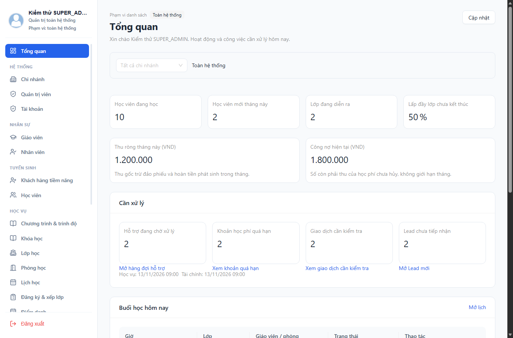
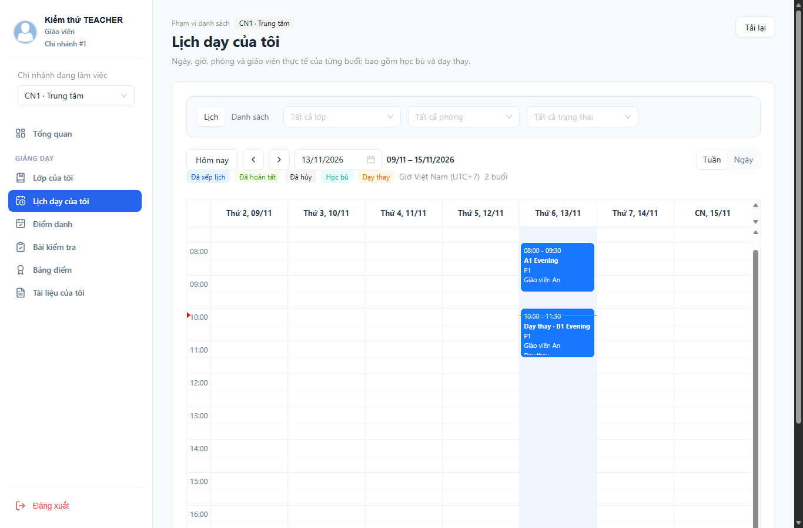
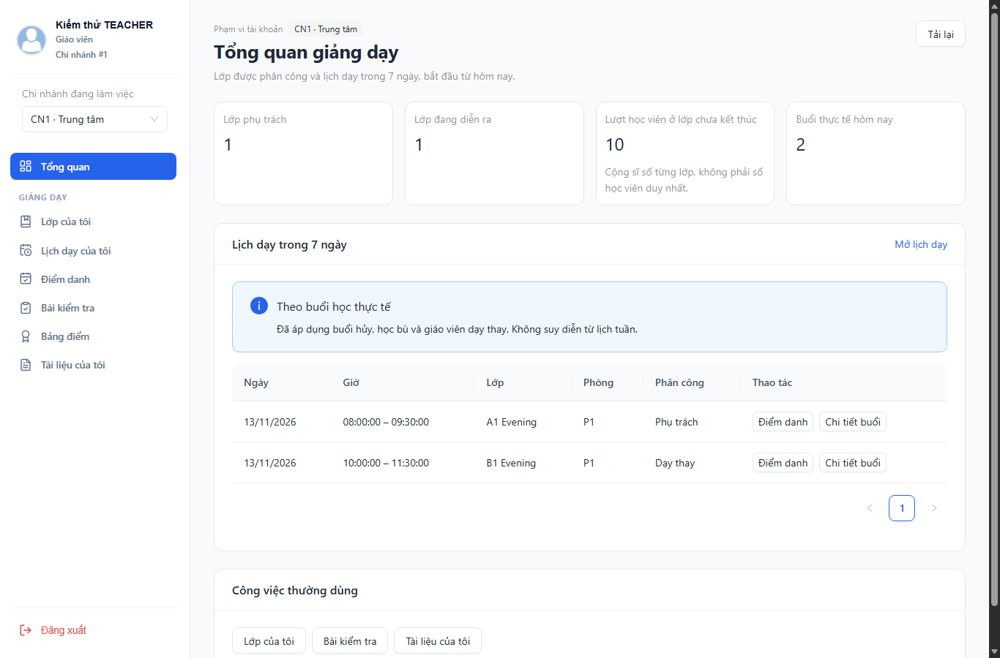

# Bàn giao web W6–W8

Cập nhật 13/11/2026. Đã triển khai source và kiểm thử tự động; nghiệm thu với hệ thống đang chạy và thiết bị thật còn chờ. Tiếp nối [W3–W5](web-w3-w4-w5-completion.md) và [lộ trình](web-management-upgrade-roadmap-2026-11-13.md).

## W6 — Học vụ và giảng dạy

- Chi tiết lớp ưu tiên thông tin lớp, danh sách học viên, lịch và liên kết học vụ. Điều hướng buổi học/điểm danh/tài liệu giữ ngữ cảnh URL để quay lại đúng bộ lọc.
- Time-grid theo múi giờ Việt Nam, có chú giải, nhãn học bù/dạy thay và thao tác mở buổi bằng bàn phím. Không bật kéo thả thay đổi lịch.
- Giáo viên dạy thay chỉ có quyền ở buổi được phân công; các liên kết điểm, bài thi và tài liệu cấp lớp chỉ hiện khi có quyền lớp. Backend tiếp tục kiểm quyền độc lập với UI.
- Cố định cột tên học viên khi cuộn bảng điểm danh/điểm. Quay lại từ biểu mẫu điểm danh vẫn hỏi khi có thay đổi chưa lưu.

## W7 — Dashboard theo công việc

- Quản lý có các số liệu học vụ và tài chính; STAFF không tải số liệu tài chính cấp quản lý; TEACHER dùng không gian giảng dạy.
- Hàng đợi thực tế gồm yêu cầu hỗ trợ đang mở/xử lý, học phí quá hạn, đơn cần rà soát và tư vấn mới. Đếm tại server trước phân trang; link mở đúng điều kiện và phạm vi đã đếm.
- ADMIN chọn chi nhánh hiện tại hoặc toàn bộ chi nhánh được phân công. SUPER_ADMIN có thể xem toàn hệ thống hoặc chọn chi nhánh. Không suy rộng quyền STAFF/TEACHER từ query URL.
- Mỗi nguồn dữ liệu có trạng thái lỗi/thử lại riêng; không hiển thị lỗi thành số 0. Thời điểm tải, kỳ báo cáo, tab và phạm vi được thể hiện rõ; bộ lọc báo cáo lưu URL.
- Doanh thu giữ định nghĩa phiếu thu hợp lệ; đơn chờ thanh toán không trở thành doanh thu.

## W8 — Chuẩn hóa và tối ưu

- Chuẩn hóa bộ lọc URL, trạng thái lỗi và thao tác quay lại ở các trang danh mục còn lại; giữ bộ lọc khi mở/đóng chi tiết. Sửa mất bộ lọc chi nhánh ở một số luồng.
- Cải thiện focus bàn phím, nội dung dài, bảng/drawer và màn hình hẹp; sidebar cố định khi trang cuộn.
- Gỡ trang placeholder phát triển; cập nhật tiêu đề, ngôn ngữ và favicon ứng dụng. Giữ các cảnh báo nghiệp vụ/sandbox có ích.
- Tách tải Login/StatusPage và bỏ import barrel gây tải sớm. JS entry/modulepreload trong HTML giảm từ 1.066.176 xuống 683.661 byte (35,9%); gzip từ 352.333 xuống 228.828 byte. Đây không phải phép đo thời gian tải hay toàn bộ tài nguyên của một trang. Build còn cảnh báo chunk dùng chung khoảng 515 kB, không bị ẩn.

## API và phạm vi

Hai GET mới, quyền SUPER_ADMIN/ADMIN/STAFF:

| Đường dẫn | Kết quả |
|---|---|
| `/api/v1/academic/stats/work-queue` | `supportActive`, `leadsNew`, `businessDate`, `observedAt` |
| `/api/v1/finance/stats/work-queue` | `tuitionOverdue`, `ordersReview`, `businessDate`, `observedAt` |

Query chung: `branchId` tùy chọn, `allAssigned=false` mặc định. Không kết hợp `branchId` với `allAssigned=true`. ADMIN dùng toàn bộ phân công hiện hành; SUPER_ADMIN dùng toàn hệ thống; STAFF không được chọn chế độ tổng hợp. ADMIN không có phân công nhận tập rỗng. Thống kê hỗ trợ lấy OPEN/IN_PROGRESS; tư vấn lấy NEW; quá hạn loại học phí hủy và cần còn nợ; rà soát đơn lấy REVIEW_REQUIRED hoặc có reviewCode.

Tham số tương thích ngược `allAssigned=false` cũng được bổ sung vào danh sách sessions, leads, support-requests, tuitions và payment-orders quản lý. STUDENT/TEACHER không được sử dụng chế độ tổng hợp này; endpoint student và hợp đồng mặc định không thay đổi. Xem [danh sách API](../api-list.md) và [hợp đồng](../api-contracts.md).

## Bằng chứng đã chạy

| Kiểm tra | Kết quả |
|---|---|
| Backend, toàn bộ 5 module | 518 đạt: auth 68, academic 233, teaching 97, finance 112, gateway 8 |
| Web | 109 test đạt; TypeScript/Vite build đạt |
| Mobile hồi quy | 81 test, typecheck và Android Expo export đạt; không sửa source mobile trong lượt này |
| Edge UI với API fixtures | 16 nhóm đạt; thêm 9 nhóm hồi quy W3–W5 đạt |

UI kiểm tra cả bốn role, đa chi nhánh, đích hàng đợi, lỗi nguồn riêng lẻ, quyền giáo viên dạy thay, thay đổi chưa lưu, lịch khi browser ở Los Angeles, bàn phím, sidebar và viewport 390px. Đây là kiểm thử trình duyệt với phản hồi API giả lập, không phải E2E backend thật.

Log/script và tổng hợp local: `storage/web-w678-evidence/summary.json`, `storage/web-w678-ui.cjs`, `storage/web-w678-regression.cjs`, `storage/web-w678-*-tests.log`. Android export ở `language-center-student-app/artifacts/w678-android-export`; không phải APK mới. ADB không có thiết bị, chưa kiểm thử cài đặt trên điện thoại.

### Ảnh giao diện kiểm thử

Ảnh dùng fixture để minh họa bố cục và trạng thái, không phải dữ liệu vận hành thật.

## Cách chạy và nghiệm thu còn lại

1. Khởi động lại academic-service và finance-service bằng cách chạy Maven/config môi trường hiện có. Giữ auth, teaching, gateway hoạt động bình thường; cập nhật/chạy lại web. W6–W8 không đổi schema, không cần reset database hay migration mới. Nếu chưa áp dụng W3–W5, đọc migration trong bàn giao W3–W5 trước.
2. SUPER_ADMIN: chọn một chi nhánh rồi toàn hệ thống, so số hàng đợi với danh sách đích. Kiểm tra trang quản lý Admin, phân công và quyền vẫn đúng.
3. ADMIN được giao hai chi nhánh: so phạm vi hiện tại/toàn phân công; đổi chi nhánh và quay lại link cũ. Chi nhánh ngoài phân công phải bị server từ chối.
4. STAFF: xử lý hỗ trợ/tư vấn, xem nợ quá hạn và buổi học; không xuất hiện thao tác đổi lịch hay báo cáo quản lý ngoài quyền.
5. TEACHER: mở buổi dạy chính và dạy thay, điểm danh, quay lại khi chưa lưu; dạy thay không được mở rộng quyền cấp lớp. Kiểm tra điểm công bố và tài liệu trên tài khoản student hiện có.
6. Với MySQL thật, đối chiếu số đếm/danh sách/CSV cùng kỳ và phạm vi; thử mất kết nối một service và tài khoản bị thu hồi phân công. Kiểm tra thao tác ghi và lịch sử bằng dữ liệu thử riêng.
7. Kiểm tra thanh toán sandbox/IPN/ngrok theo cấu hình đang dùng và APK trên điện thoại. Lượt này không tạo giao dịch thật, không gửi push, không triển khai production và không tự sửa database.

W1–W8 đã có triển khai source; các mục nghiệm thu môi trường thật ở trên chưa được đánh dấu hoàn tất.
