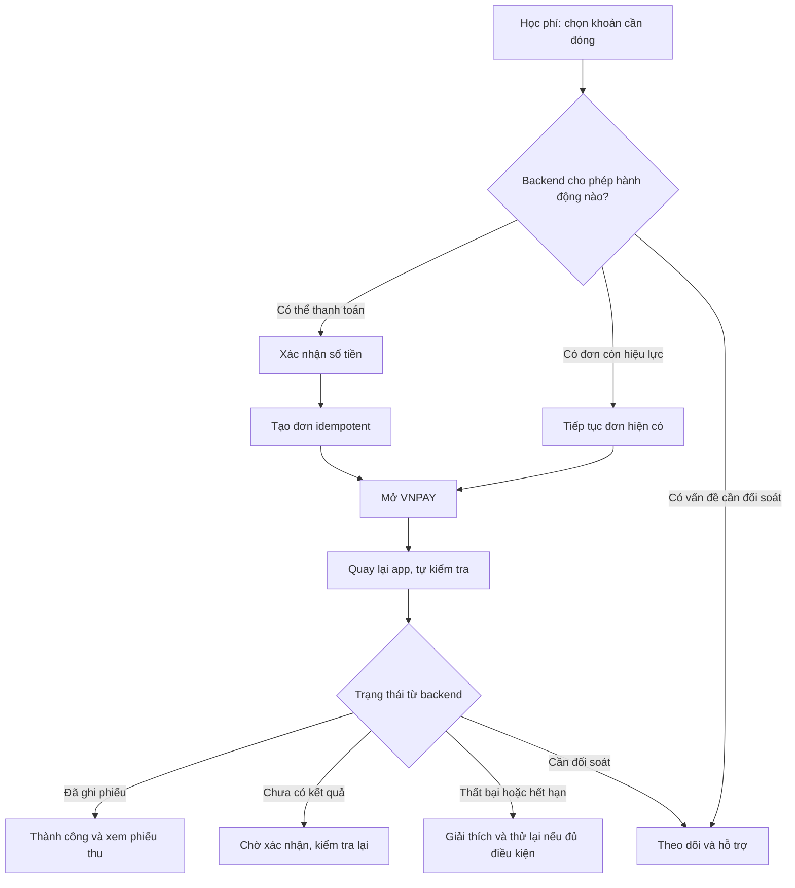

# Kế hoạch tối ưu Học phí và Thanh toán

Ngày rà soát: 12/11/2026. Giai đoạn 1–4 đã triển khai source và kiểm thử; giai đoạn 5–6 còn tiếp tục. Xem [kết quả và giới hạn nghiệm thu](payment-flow-phases-1-4-completion.md). Các phần dưới giữ nội dung kế hoạch và hiện trạng tại thời điểm rà soát trước khi sửa.

Phạm vi chính: app học viên `language-center-student-app`, Finance API và trang Return VNPAY. Web vận hành chỉ điều chỉnh các điểm liên quan để nhân viên tra cứu và hỗ trợ cùng một giao dịch. Kết luận dựa trên đọc source hiện tại; đây không phải kết quả nghiệm thu toàn bộ giao dịch trên điện thoại.

## 1. Kết luận

Ứng dụng đã có học phí, công nợ, tạo đơn online, mở VNPAY, tra trạng thái và phiếu thu. Vấn đề chính là tổ chức màn hình và xử lý ngoại lệ: người dùng phải hiểu quá nhiều khái niệm kỹ thuật để hoàn thành một việc là đóng học phí.

Giữ mục **Học phí** làm điểm vào duy nhất. Học viên cần biết: còn thiếu bao nhiêu, đóng cho lớp nào, giao dịch đang ở đâu và phiếu thu nằm ở đâu. Đơn online vẫn tồn tại để chống trùng và phục hồi, nhưng trở thành chi tiết giao dịch thay vì một quy trình riêng bắt người dùng quản lý.

Không viết lại thuật toán ký VNPAY, không xóa đơn/phiếu cũ và không đổi cách tính công nợ chỉ để đơn giản giao diện.

## 2. Các vấn đề đã thấy trong code

| Ưu tiên | Hiện trạng có bằng chứng | Tác động | Hướng sửa |
|---|---|---|---|
| P0 | `FinanceDetail.tsx` hướng dẫn liên hệ trung tâm để đóng học phí ngay phía trên `Checkout` online | Hai hướng dẫn mâu thuẫn | Nội dung theo khả năng thanh toán thực tế; liên hệ là hành động phụ |
| P0 | `Checkout.tsx`: tạo đơn xong chuyển sang chi tiết, người dùng phải bấm mở cổng lần nữa | Thừa bước; tạo đơn dễ bị hiểu nhầm là đã thanh toán | Một nút xác nhận, sau tạo/phục hồi đơn thì mở VNPAY; mở thất bại có nút tiếp tục |
| P0 | `PENDING` mang nhãn “Chờ xác nhận” từ lúc vừa tạo đơn, chưa mở ngân hàng | Học viên không biết có cần thao tác thêm không | Phân biệt hướng dẫn trình bày trước/sau khi mở cổng; không giả lập trạng thái ngân hàng |
| P0 | `Checkout.tsx` giữ pending intent cho mọi lỗi; UI đưa cả “Khôi phục” và “Gửi lại cùng yêu cầu” | Có thể mắc lại ở yêu cầu bị từ chối rõ ràng, hoặc không biết chọn nút nào | Phân loại lỗi có mã nghiệp vụ; tự khôi phục với cùng requestId khi chưa rõ kết quả |
| P0 | Backend chặn đơn mới khi đã có đơn chờ; app chưa chủ động tìm đơn đó trước khi tạo | Đụng 409 nhưng không được dẫn tới giao dịch cần tiếp tục | Backend trả ngữ cảnh hành động/đơn thuộc sở hữu; app mở đơn phù hợp |
| P0 | API client đã có `ApiError.kind/status/code`, nhưng Finance trả chủ yếu `message`; client hiển thị 409 chung | Không phân biệt đã có đơn, số dư đổi, hay cần đối soát | Chuẩn hóa error code và ánh xạ thông báo/hành động tại app |
| P1 | `FinanceList.tsx` đặt nút Đơn online, Phiếu thu trước tổng quan và danh sách học phí | Điều hướng lấn át nhiệm vụ chính | Tổng công nợ trước, khoản cần đóng tiếp theo, lịch sử là mục con |
| P1 | Chi tiết học phí có nhiều số liệu, điều chỉnh, hướng dẫn và nút cùng cấp | Khó tìm nút cần bấm | Ưu tiên số còn thiếu và một nút chính; chi tiết kế toán mở rộng khi cần |
| P1 | `Orders.tsx` chủ yếu có trạng thái, tiền, ngày; chưa có tên lớp/khóa ngay trên giao dịch | Khó nhận diện nhiều khoản/giao dịch | Bổ sung ngữ cảnh lớp, khóa, mã tham chiếu hiển thị ngắn |
| P1 | `OrderDetail.tsx` hiển thị UUID dài, nhiều nút, cùng mẫu nội dung cho các kết quả | Không có ưu tiên rõ giữa tiếp tục, chờ và xem phiếu | Giao diện theo kết quả, mỗi trạng thái một hành động chính |
| P1 | Trang Return chỉ hướng dẫn quay lại app; có custom scheme khi callback hợp lệ | Trên Expo Go hoặc trình duyệt có thể phải quay lại thủ công | Thiết kế trang quay lại rõ ràng và luồng AppState/focus; kiểm thử development build riêng |
| P1 | Tổng quan học phí và chi tiết tự tải theo màn hình; chưa có phối hợp làm mới sau thanh toán | Người dùng có thể thấy số cũ khi chuyển màn hình/thời điểm cập nhật khác nhau | Làm mới đơn, học phí, tổng quan, phiếu thu sau xác nhận; giữ dữ liệu cũ khi đang tải |
| P1 | `pendingCheckout` là một slot cho toàn app, native lưu SecureStore, web chỉ giữ bộ nhớ | Đang phục hồi khoản A có thể xuất hiện khi xem khoản B; reload web mất intent cục bộ | Bộ điều phối rõ account/tuition/request; phục hồi server và chuyển đúng khoản |
| P2 | `OnlineOrderService.list()` lấy toàn bộ rồi lọc/phân trang trong bộ nhớ và sinh checkout URL cho danh sách | Tốn tài nguyên, đưa URL ký vào nơi chỉ cần xem tóm tắt | Phân trang SQL, tính trạng thái hiệu lực nhất quán, chỉ lấy URL khi thực sự tiếp tục |

Các mô tả trên là hành vi nhìn thấy từ source. Không quy lỗi toàn bộ UI cho backend; backend đã có nhiều bảo vệ tài chính cần giữ.

## 3. Cấu trúc giao diện đề xuất

Giữ nguyên 5 tab chính hiện có. Không thêm tab Thanh toán ở thanh điều hướng dưới.

Trong tab **Học phí**, có hai mục nội bộ:

- **Cần đóng**: tổng còn phải đóng, cảnh báo quá hạn/cần xử lý, danh sách khoản học phí.
- **Lịch sử**: mặc định phiếu thu đã ghi nhận; mục con “Giao dịch online” để tra lần thanh toán đang chờ, hết hạn hoặc thất bại. Có thể dùng bộ lọc để xem tất cả, nhưng không cộng tiền đơn online với tiền phiếu thu.

Một phiếu thu có thể xuất phát từ thu trực tiếp hoặc online. Giao dịch online đã thành công cần liên kết tới phiếu thu, không trình bày thành hai lần đóng tiền độc lập.

Giữ các route `/payment-orders`, `/payment-orders/[id]`, `/receipts`, `/receipts/[id]` để link thông báo và lịch sử cũ hoạt động. Thay vị trí truy cập và nội dung, không xóa route một cách đột ngột.

### Màn hình Học phí

- Số lớn: **Còn phải đóng**; thông tin nhỏ: đã đóng, số khoản quá hạn.
- Khi tổng chưa đủ dữ liệu: ghi “Một số khoản đang được trung tâm kiểm tra”; không thay bằng 0 đ.
- Card khoản học phí: lớp/khóa, số còn thiếu, hạn đóng, nhãn trạng thái và một hành động phù hợp.
- Có giao dịch đang chờ/cần kiểm tra thì card dẫn tới giao dịch đó, không mời tạo đơn mới.
- Khoản đã hủy, đóng đủ và lịch sử điều chỉnh nằm trong bộ lọc/chi tiết; không trộn vào danh sách cần đóng mặc định.
- Giữ cảnh báo dữ liệu cần xác minh; không che thông tin tài chính quan trọng để màn hình đẹp hơn.

### Chi tiết học phí và xác nhận thanh toán

Phần đầu: tên lớp, khóa, số còn phải đóng, hạn đóng. Dưới đó là nút chính theo trạng thái. Chi tiết gốc/giảm trừ/đóng dư/lịch sử điều chỉnh là phần mở rộng.

Bấm **Thanh toán** mở phần xác nhận gồm lớp, số tiền, phương thức VNPAY và nhãn sandbox nhỏ nhưng rõ. Mặc định chọn toàn bộ số còn thiếu. Cho phép **Đóng một phần** bằng lựa chọn riêng; không bắt mọi học viên nhập lại số tiền mặc định.

Nút cuối: **Thanh toán [số tiền]**. Sau khi backend chấp nhận, tự mở VNPAY trên native. Với web, thiết kế mở cửa sổ từ thao tác người dùng để tránh popup blocker; nếu bị chặn, hiển thị “Mở trang thanh toán”, không tự gửi lại yêu cầu tạo đơn.

### Màn hình giao dịch/kết quả

Trình bày số tiền + lớp + kết quả rõ, không bắt đọc UUID. Mã ngắn chỉ để hiển thị/hỗ trợ; UUID đầy đủ vẫn là khóa kỹ thuật, có thể sao chép ở phần chi tiết. Không giả định cắt UUID luôn duy nhất.

| Tình huống | Nội dung chính | Hành động chính |
|---|---|---|
| Đơn còn hiệu lực, học viên chưa đi tới cổng hoặc chủ động quay lại | Có thể tiếp tục thanh toán | Tiếp tục thanh toán |
| Vừa trở về từ ngân hàng, backend chưa xác nhận | Đang kiểm tra kết quả | Tự kiểm tra có giới hạn; nút Kiểm tra lại khi cần |
| Backend đã ghi phiếu | Thanh toán thành công | Xem phiếu thu |
| Ngân hàng xác nhận thất bại | Thanh toán chưa thành công | Thử lại khi backend cho phép |
| Hết hạn và không có dấu hiệu cần kiểm tra | Phiên thanh toán đã hết hạn | Tạo phiên mới sau kiểm tra điều kiện |
| Có tiền/sự kiện chưa phân bổ hoặc cần đối soát | Trung tâm đang kiểm tra giao dịch | Gửi yêu cầu hỗ trợ gắn giao dịch |
| Không tải được trạng thái | Chưa kiểm tra được kết quả | Thử kiểm tra lại; không khẳng định thất bại |

Việc mở/đóng browser chỉ là dấu hiệu trải nghiệm. Không chứng minh đã trả tiền hay đã hủy. `SUCCEEDED` kèm `reviewRequired` có thể có giao dịch bổ sung cần xử lý: vẫn hiển thị phiếu đã ghi và cảnh báo riêng, không biến thành một lần đóng mới.

## 4. Luồng mục tiêu

Luồng thông thường chỉ cần chọn khoản và xác nhận thanh toán trước khi tới VNPAY. Không cần ghé danh sách đơn và không cần tự chọn giữa “khôi phục” với “gửi lại UUID”.

## 5. Quy tắc nghiệp vụ phải giữ

- Công nợ dựa trên học phí đang hiệu lực và phiếu thu/điều chỉnh hợp lệ. Đơn PENDING không trừ công nợ.
- Không xác nhận thành công dựa vào URL Return, kết quả đóng trình duyệt, local state hay thông báo push. Return hỗ trợ điều hướng; IPN hoặc truy vấn nhà cung cấp đã xác minh mới đi vào luồng ghi nhận tài chính.
- Một khoản đang có đơn chờ hoặc giao dịch cần đối soát không được tạo thêm đơn trái quy tắc hiện tại. Không tự mở thêm phiên khi chưa biết kết quả request trước.
- Khi timeout/mất mạng/HTTP5xx không chắc kết quả: tra requestId và thử lại cùng nội dung, cùng requestId. Không sinh UUID mới để né lỗi.
- Chỉ bỏ intent khi có bằng chứng yêu cầu chưa được chấp nhận hoặc đã phục hồi được đơn. Không coi mọi 4xx, lỗi proxy hay response sai định dạng là bằng chứng chắc chắn.
- Khi backend xác nhận từ chối do số dư thay đổi, làm mới số dư, xác nhận lại số tiền và sinh intent mới theo hành động được cho phép.
- Callback trùng không ghi thêm phiếu. Tiền đến muộn/vượt nợ/thu tiền trực tiếp song song phải qua kiểm tra hiện có.
- Hết hạn là hết thời gian dùng phiên; không chứng minh ngân hàng chưa trừ tiền. Nếu người dùng báo đã trừ tiền hoặc có bằng chứng cần kiểm tra, chuyển hỗ trợ/đối soát trước khi thử lại.
- Không thêm nút “Tôi đã thanh toán” để cập nhật tiền. Có thể có “Tôi cần hỗ trợ giao dịch” với ngữ cảnh đơn.
- Tính toán tiền phía server dùng BigDecimal; phía app giữ decimal string. Nhập tiền VND có định dạng hiển thị dễ đọc, không chuyển sang cộng/trừ bằng số thực JavaScript.
- Đóng dư/đảo phiếu/hoàn tiền vẫn có lịch sử riêng. Không coi thao tác kế toán là bằng chứng VNPAY đã hoàn về ngân hàng.

## 6. Lộ trình triển khai

### Giai đoạn 1 — Hợp đồng trạng thái và hành động

Mục tiêu: backend đưa đủ thông tin để app biết phải làm gì, tránh đoán bằng chuỗi thông báo.

- Bổ sung DTO ngữ cảnh thanh toán theo tuition: điều kiện được thanh toán, số dư hiện tại, đơn có thể tiếp tục, lý do bị chặn và hành động được phép. Giữ API hiện tại cho client cũ.
- Có thể đặt endpoint mới `GET /student/me/tuitions/{id}/payment-context`; đây là API đề xuất, chưa tồn tại. Query này không tạo đơn hoặc ghi tiền.
- Thêm mã lỗi ổn định cho tạo đơn/khôi phục: đã có đơn chờ, cần đối soát, số dư thay đổi, cấu hình tắt, intent không khớp. Mọi id trả về phải thuộc học viên hiện tại.
- Kiểm tra lại điều kiện dưới khóa trong POST tạo đơn; payment-context chỉ phục vụ hiển thị, không thay thế kiểm tra cạnh tranh.
- Bổ sung tên lớp/khóa và mã hiển thị cho DTO giao dịch/phiếu nếu cần, tránh app gọi từng chi tiết để ghép tên.
- Tách trạng thái tài chính với trạng thái thao tác UI. Không thêm trạng thái PAID chỉ vì đã mở browser.
- Phân trang/filter đơn tại database với trạng thái hết hạn hiệu lực nhất quán; không sinh URL checkout cho toàn bộ danh sách. Bảo đảm tương thích client hiện hành nếu thay trường URL.

Nghiệm thu: cùng một khoản luôn đưa ra hành động nhất quán; đang chờ dẫn tới đúng đơn; không lộ đơn khác; race thu trực tiếp/tạo đơn vẫn được chặn đúng.

### Giai đoạn 2 — Sắp xếp lại Học phí và Lịch sử

- Refactor `FinanceList`, `FinanceDetail`, `components`, bổ sung cấu trúc nội bộ Cần đóng/Lịch sử bằng component native và theme hiện tại.
- Ưu tiên tổng còn nợ, khoản quá hạn và hành động theo payment-context.
- Đưa phiếu thu và giao dịch online về lịch sử có phân biệt; giữ link cũ.
- Gỡ hướng dẫn đóng tiền mâu thuẫn; thu gọn phần kế toán dài vào mục mở rộng.
- Lịch sử có tên lớp/khóa, số tiền, thời gian và trạng thái; không hiển thị như hai khoản thu khi online đã sinh phiếu.
- Mỗi card tối đa một nút chính; liên hệ/hỗ trợ là đường dẫn phụ theo tình huống.

Nghiệm thu: người dùng biết ngay số còn phải đóng và khoản nào cần xử lý; tìm phiếu thu mà không cần hiểu “đơn” là gì.

### Giai đoạn 3 — Điều phối thanh toán và phục hồi tự động

- Tách logic trong `Checkout` thành bộ điều phối: xác nhận → gửi intent → phục hồi/tạo đơn → mở browser → kiểm tra kết quả.
- Mặc định số còn thiếu; “Đóng một phần” là tùy chọn. Số tiền thay đổi phải tạo intent mới chỉ sau khi intent cũ đã rõ kết quả.
- Tự tiếp tục đơn phù hợp đã tồn tại; không hiển thị lỗi 409 chung rồi yêu cầu tự tìm.
- Với mất phản hồi, tự tra requestId rồi retry cùng intent có giới hạn; một nút “Thử lại” dễ hiểu khi cần can thiệp.
- Với từ chối chắc chắn, bỏ trạng thái khôi phục sai, tải lại điều kiện và hướng dẫn cụ thể.
- Pending intent được quản lý rõ theo account và khoản; khi mở khoản B nhưng đang phục hồi khoản A, dẫn đúng khoản A thay vì gửi nhầm nội dung.
- Giữ chống double tap, đổi account/đăng xuất khi request đang chạy, đóng app và browser mở thất bại.

Nghiệm thu: một lần xác nhận mở được VNPAY; double tap/timeout/restart app không tạo đơn trùng và không mắc ở khôi phục vô hạn.

### Giai đoạn 4 — Kết quả, Return và cập nhật số dư

- Refactor `OrderDetail` thành giao diện theo trạng thái; giảm UUID dài và các nút cùng cấp.
- Sau trở về từ browser hoặc app active, tự kiểm tra ngay; polling có giới hạn thời gian/backoff, dừng khi mất focus, offline hoặc kết quả đã ổn định.
- Khi backend xác nhận ghi phiếu, làm mới học phí, tổng quan, lịch sử và thông báo liên quan; tránh hiển thị số cũ như dữ liệu vừa xác nhận.
- Trang Return có nội dung dễ hiểu và nút quay lại app; phân biệt production/development build với Expo Go. Không hứa custom scheme tự mở được trong mọi môi trường.
- Không đưa token đăng nhập, secret hoặc trạng thái thanh toán có thể tự sửa vào deep link. App luôn lấy lại đơn từ API có ownership.
- Nhãn sandbox ngắn và rõ. Hướng dẫn thẻ test có thể nằm trong “Hướng dẫn thử nghiệm” chỉ ở sandbox; không lấn át luồng sản phẩm.

Nghiệm thu: thành công có phiếu thu và số dư đúng; Return đến trước IPN vẫn chờ đúng; hủy browser không bị ghi thất bại giả; mất mạng có cách kiểm tra lại.

### Giai đoạn 5 — Đồng bộ nơi vận hành trên web

- Liên kết Học phí → giao dịch online → phiếu thu theo cùng khoản; giữ menu hiện tại nếu vẫn rõ vai trò.
- Bổ sung tìm kiếm bằng học viên/lớp/mã hiển thị, ngữ cảnh đơn trong drawer và lối đi tới phiếu tương ứng.
- STAFF xem, tra cứu, tiếp nhận hỗ trợ theo chi nhánh; ADMIN/SUPER_ADMIN đối soát theo quyền hiện tại. TEACHER không được mở dữ liệu tài chính chỉ vì có link.
- Bằng chứng callback và mã kỹ thuật nằm trong phần chi tiết vận hành, không đẩy sang giao diện học viên.
- Yêu cầu hỗ trợ gắn đơn phải mở được đơn/học phí liên quan. Nếu hệ thống chưa có loại liên kết PAYMENT_ORDER thì bổ sung rõ vào hợp đồng và bộ kiểm tra quyền, không giả dùng id phiếu thu.
- Không thêm nút xác nhận thanh toán thủ công cho giao dịch VNPAY; giữ audit/version/idempotency của đối soát.

Nghiệm thu: nhân viên nhận mã hỗ trợ có thể xác định đúng học viên, khoản, đơn và phiếu; người không được phân quyền không tra cứu chéo chi nhánh.

### Giai đoạn 6 — Kiểm thử và bàn giao

- Backend: ngữ cảnh/hành động, ownership, các mã lỗi, cạnh tranh, số dư và phân trang trạng thái hiệu lực.
- App: tạo đơn thành công, double tap, definite rejection, POST timeout nhưng server đã tạo, mất SecureStore, account switch, đơn cũ hết hạn, đơn cần đối soát và quay lại từ browser.
- End-to-end sandbox: thanh toán đủ/một phần bằng thẻ test; thất bại; Return trước IPN; IPN lặp; app đóng trước callback; thu trực tiếp song song; kiểm tra phiếu và công nợ.
- Kiểm tra Android thật: browser mở/đóng, quay lại app, focus/AppState, deep link trong development build. Kiểm tra Expo Go và web như các môi trường riêng, ghi đúng giới hạn.
- Cập nhật tài liệu và ảnh màn hình luồng mới. Phân biệt “code/test nội bộ đạt” với “đã nhận IPN và ghi phiếu từ VNPAY sandbox”.

Nghiệm thu cuối: học viên hoàn thành đóng học phí mà không cần hiểu requestId, khôi phục đơn hoặc đối soát kỹ thuật; tài chính vẫn chỉ ghi nhận từ bằng chứng đã xác minh.

## 7. Thứ tự và giới hạn thay đổi

Thực hiện lần lượt **1 → 2 → 3 → 4 → 5 → 6**. Giai đoạn 1–4 là ưu tiên trước mắt để hết rối trên app; G5 hỗ trợ vận hành và G6 xác nhận toàn luồng.

Các thay đổi cấu trúc UI không cần reset database. Nếu thêm trường mã hiển thị hoặc metadata thao tác, phải migration cộng thêm và backfill có kiểm tra; không thay id/merchantRef của giao dịch cũ. Triển khai DTO/API tương thích trước, cập nhật app sau, chỉ gỡ hợp đồng cũ khi không còn client dùng.

Giai đoạn 1–4 đã cập nhật backend/app theo tài liệu hoàn thành. Không reset dữ liệu hoặc đổi cấu hình merchant VNPAY. Phần vận hành web của giai đoạn 5 vẫn giữ hiện trạng trước đợt tối ưu này.
