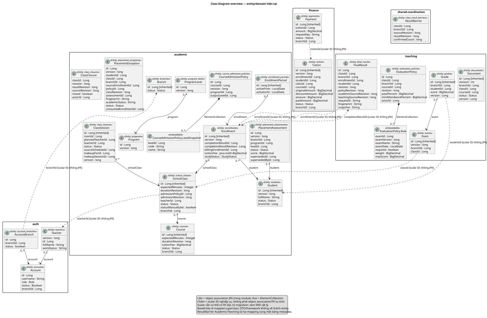

# Chương 4 — Thiết kế hệ thống

## 4.1. Kiến trúc và quyền sở hữu dữ liệu

FE gọi Gateway; Gateway route về Auth/Academic/Teaching/Finance. Auth quản lý tài khoản/nhân sự, Academic quản lý tuyển sinh/học vụ, Teaching quản lý bài/điểm/tài liệu/final, Finance quản lý phí/thu/journal. Backend theo controller → service → repository/entity. Các DB connection/transaction tách theo service nhưng cùng schema vật lý; có ngoại lệ phối hợp account lock và barrier chung, không tuyên bố tuyệt đối không cross-service SQL.

## 4.2. Cơ sở dữ liệu

Target V013 có **53 bảng/625 cột**, được đối soát bằng metadata trên bản sao ở G14 và nghiệm thu DB-01 G17/G18. Đây là schema target, không tự động áp dụng lên database người dùng còn33 bảng/388 cột đã thấy ở review. Danh mục nguồn: [từ điển](../design/data-dictionary.md), [metadata](../design/schema-v013.metadata.json), [entity catalog](../design/entity-catalog.md), [kiểm chứng schema](../design/schema-verification.md).

Các nhóm chính gồm accounts/account_branches/account_branch_events/teacher_profile_events; programs/program_levels/course_admission_policies/course_admission_levels/course_duration_plans; students/enrollments/enrollment_periods/learning_events; placement_assessments/assessment_events/placement_exceptions/enrollment_admissions; class_sessions/attendances/attendance_changes; evaluation_policies/evaluation_states/exam_candidates/final_results/result_reopens; documents/document_events; **tuition/payments/tuition_adjustments/payment_corrections**. Tên bảng/khóa/cột chi tiết lấy từ từ điển, không dùng receipts, tuitions hay bảng audit tự đặt.

## 4.3. Mô hình lớp, quan hệ và bất biến

Có52lớp @Entity trong source mapping. Một bảng có thể được hai service ánh xạ cho điều phối, một số bảng collection không có entity riêng, và final_results.current_enrollment_id là cột generated không ánh xạ field. Vì vậy không suy số entity bằng số bảng. Quan hệ JPA, FK SQL và tham chiếu ID mềm được phân biệt trong [thiết kế](../design/README.md).

EnrollmentPeriod là khoảng [activeFrom,activeUntil), không tự điền lịch sử legacy. @Version có13lớp đã kiểm kê; revision policy/plan/closure/result không tự là @Version. Chốt giữ snapshot; reopen thay state/lưu audit và cho revision mới thay vì ghi đè căn cứ cũ. Xem [lifecycle/invariants](../design/lifecycles-and-invariants.md).

## 4.4. Thiết kế động

Năm cặp Activity/Sequence đã đối chiếu lại controller/DTO/service: ghi danh–tuition AFTER_COMMIT; thu–retry; đề nghị/duyệt/consume ngoại lệ; bàn giao–INACTIVE; chốt/mở lại–completion–đóng lớp. [Thuyết minh giao thức](../design/dynamic-workflows.md) nêu endpoint/body, thứ tự khóa, transaction cục bộ và cách phục hồi. Barrier/token/sourceRevision phụ thuộc shared schema; HTTP không tạo distributed transaction.

## 4.5. Danh mục hình nguồn và SVG

Tổng32 hình:5Use Case,9ERD,8Class,5Activity,5Sequence. Hình overview là tổng quan; hình module đầy đủ cột/thuộc tính phù hợp phụ lục khổ lớn. Cần đánh số/caption theo mẫu khoa sau dàn trang.

| Loại | Nguồn thật trong repository | Hình render |
|---|---|---|
|Activity|[activity-enrollment-tuition.puml](../diagrams/activity-enrollment-tuition.puml)|[SVG](../diagrams/activity-enrollment-tuition.svg)|
|Activity|[activity-final-result-lock.puml](../diagrams/activity-final-result-lock.puml)|[SVG](../diagrams/activity-final-result-lock.svg)|
|Activity|[activity-payment-retry.puml](../diagrams/activity-payment-retry.puml)|[SVG](../diagrams/activity-payment-retry.svg)|
|Activity|[activity-placement-exception.puml](../diagrams/activity-placement-exception.puml)|[SVG](../diagrams/activity-placement-exception.svg)|
|Activity|[activity-teacher-handover.puml](../diagrams/activity-teacher-handover.puml)|[SVG](../diagrams/activity-teacher-handover.svg)|
|Class|[class-academic-catalog.puml](../diagrams/class-academic-catalog.puml)|[SVG](../diagrams/class-academic-catalog.svg)|
|Class|[class-academic-learning.puml](../diagrams/class-academic-learning.puml)|[SVG](../diagrams/class-academic-learning.svg)|
|Class|[class-academic-placement.puml](../diagrams/class-academic-placement.puml)|[SVG](../diagrams/class-academic-placement.svg)|
|Class|[class-auth.puml](../diagrams/class-auth.puml)|[SVG](../diagrams/class-auth.svg)|
|Class|[class-finance.puml](../diagrams/class-finance.puml)|[SVG](../diagrams/class-finance.svg)|
|Class|[class-overview.puml](../diagrams/class-overview.puml)|[SVG](../diagrams/class-overview.svg)|
|Class|[class-shared-coordination.puml](../diagrams/class-shared-coordination.puml)|[SVG](../diagrams/class-shared-coordination.svg)|
|Class|[class-teaching.puml](../diagrams/class-teaching.puml)|[SVG](../diagrams/class-teaching.svg)|
|ERD|[erd-academic-catalog.puml](../diagrams/erd-academic-catalog.puml)|[SVG](../diagrams/erd-academic-catalog.svg)|
|ERD|[erd-academic-learning.puml](../diagrams/erd-academic-learning.puml)|[SVG](../diagrams/erd-academic-learning.svg)|
|ERD|[erd-academic-placement.puml](../diagrams/erd-academic-placement.puml)|[SVG](../diagrams/erd-academic-placement.svg)|
|ERD|[erd-auth.puml](../diagrams/erd-auth.puml)|[SVG](../diagrams/erd-auth.svg)|
|ERD|[erd-finance.puml](../diagrams/erd-finance.puml)|[SVG](../diagrams/erd-finance.svg)|
|ERD|[erd-logical.puml](../diagrams/erd-logical.puml)|[SVG](../diagrams/erd-logical.svg)|
|ERD|[erd-physical-overview.puml](../diagrams/erd-physical-overview.puml)|[SVG](../diagrams/erd-physical-overview.svg)|
|ERD|[erd-shared-coordination.puml](../diagrams/erd-shared-coordination.puml)|[SVG](../diagrams/erd-shared-coordination.svg)|
|ERD|[erd-teaching.puml](../diagrams/erd-teaching.puml)|[SVG](../diagrams/erd-teaching.svg)|
|Sequence|[sequence-enrollment-tuition.puml](../diagrams/sequence-enrollment-tuition.puml)|[SVG](../diagrams/sequence-enrollment-tuition.svg)|
|Sequence|[sequence-final-result-lock.puml](../diagrams/sequence-final-result-lock.puml)|[SVG](../diagrams/sequence-final-result-lock.svg)|
|Sequence|[sequence-payment-retry.puml](../diagrams/sequence-payment-retry.puml)|[SVG](../diagrams/sequence-payment-retry.svg)|
|Sequence|[sequence-placement-exception.puml](../diagrams/sequence-placement-exception.puml)|[SVG](../diagrams/sequence-placement-exception.svg)|
|Sequence|[sequence-teacher-handover.puml](../diagrams/sequence-teacher-handover.puml)|[SVG](../diagrams/sequence-teacher-handover.svg)|
|Use Case|[use-case-admin.puml](../diagrams/use-case-admin.puml)|[SVG](../diagrams/use-case-admin.svg)|
|Use Case|[use-case-overview.puml](../diagrams/use-case-overview.puml)|[SVG](../diagrams/use-case-overview.svg)|
|Use Case|[use-case-staff.puml](../diagrams/use-case-staff.puml)|[SVG](../diagrams/use-case-staff.svg)|
|Use Case|[use-case-super-admin.puml](../diagrams/use-case-super-admin.puml)|[SVG](../diagrams/use-case-super-admin.svg)|
|Use Case|[use-case-teacher.puml](../diagrams/use-case-teacher.puml)|[SVG](../diagrams/use-case-teacher.svg)|

Kiểm cú pháp/render/hash chỉ bảo đảm file/hình đồng bộ; tính đúng của luồng được kiểm bằng source review và bằng chứng runtime. Không dùng số lượng hình làm thước đo mức hoàn thành nghiệp vụ.
