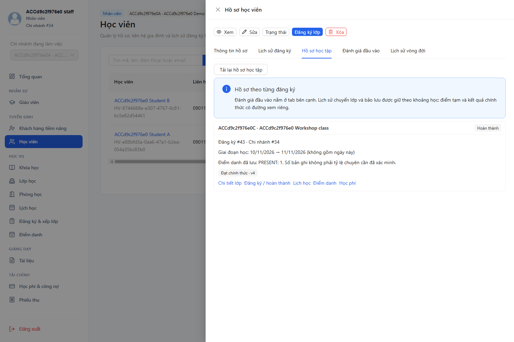
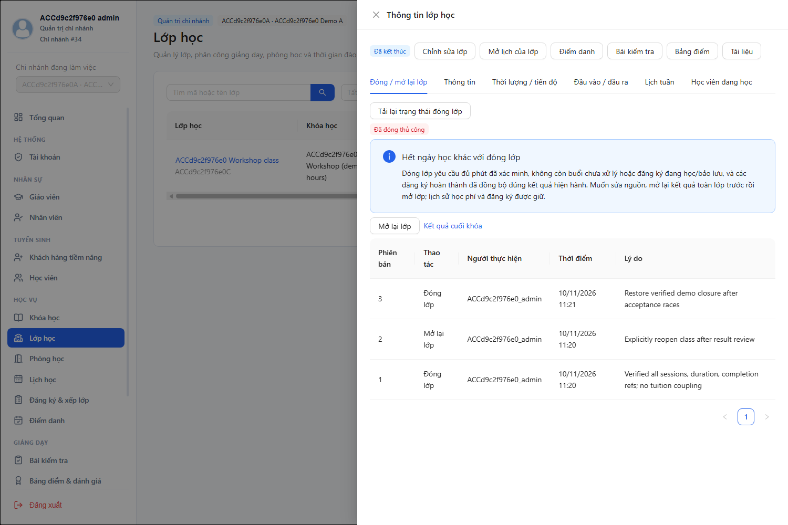
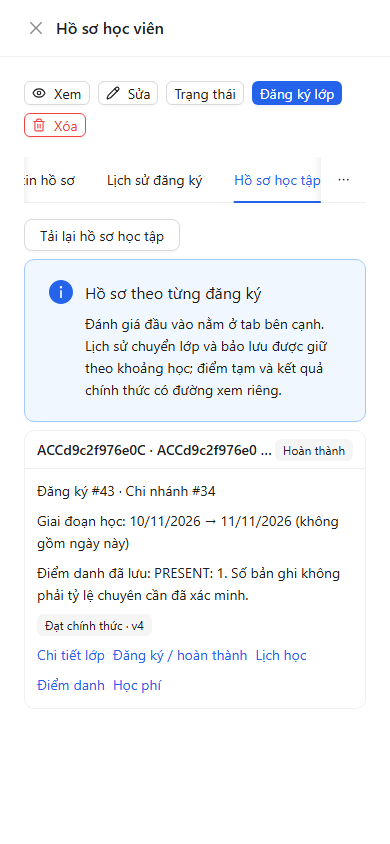
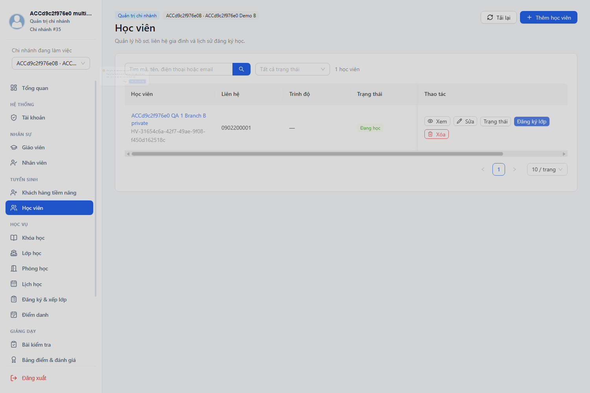

# Chương 6 — Kiểm thử và đánh giá

## 6.1. Phương pháp và nguồn kết quả

Kết quả ngày 10/11/2026 được tách theo tầng. Regression source đã chạy ở review cùng ngày; nghiệm thu G17/G18 chạy riêng trên MySQL thật với JAR private prod/validate, Gateway và Edge. G19 chỉ sửa tài liệu/hình, không chạy lại toàn bộ nghiệp vụ để đổi ngày bằng chứng. Không có tỷ lệ coverage nguồn hoặc kiểm thử tải để công bố100% bao phủ.

| Tầng | Kết quả đã ghi nhận | Bằng chứng và giới hạn |
|---|---|---|
| Backend Maven |335 tests,0failure/error: Auth54,Academic159,Teaching74,Finance40,Gateway8|[Tổng đếm](../../../storage/review-20261110-test-counts.json), [log Maven](../../../storage/review-20261110-maven.log); hỗn hợp JUnit/unit/Spring/H2/mock/HTTPstub, không phải335 ca MySQL E2E|
| Frontend Node |82 đạt|[log](../../../storage/review-20261110-fe-tests.log), package.json dùng node --test; utility/contract tests, không gọi82 ca component DOM hoặc Vitest|
| Lint/build |Đạt trong review cùng ngày|[lint](../../../storage/review-20261110-fe-lint.log), [build](../../../storage/review-20261110-fe-build.log); không suy tốc độ/SLA hoặc thay browser|
| Operations |9/9 đạt|[log](../../../storage/acceptance-operations-tests.log)|
| Health/security smoke |19 kiểm tra đạt tại28080–28084|[smoke](../../../storage/acceptance/20261110-0365823a/smoke.json); không phải kiểm tải|
| Nghiệm thu API/MySQL/UI |86/86 đạt trong lượt sạch20261110-0365823a|[report từng ca](../../reviews/2026-11-10-g17-g18-real-acceptance.md), [manifest](../../reviews/2026-11-10-g17-g18-evidence.json)|
| Tài liệu/hình |Kiểm cú pháp, render, hash, link và source/schema|G15/G16/G19 có log kiểm tra riêng; kiểm tĩnh không chứng nhận nghiệp vụ|

## 6.2. Thiết kế dữ liệu và expected trước chạy

Nguồn được backup online-rehearsal rồi restore vào **lc_rehearsal_1794284386660_859a8d**; V001–V013 chỉ áp dụng trên bản sao, 53 bảng/625 cột. Năm JVM riêng ở28080–28084, FE25173, Edge CDP29388. [expected.json](../../../scripts/acceptance/expected.json) và mỗi assertion lưu expected trước thao tác kiểm tra. ID/hash động đối chiếu với dữ liệu nhận trước và snapshot trước thay đổi, không tự gán Actual.

Fixture có4 role, hai chi nhánh demoA/B cùng QA riêng. Workshop180 phút với một buổi00:00–03:00 trong ngày thử; không trình bày là khóa45giờ hay chứng nhận CEFR. A có đầu vàoB1 hợp tập chấp nhận; B đầu vàoA2 cần ngoại lệ học thuật. Học phí mỗi enrollment3M; chỉ A đóng1M+2M. B còn nợ3M nhưng vẫn được xét hoàn thành học thuật. Điểm cuối A85/PASS,B40/FAIL với ngưỡng60% và chuyên cần80%; thiếu điểm bài bắt buộc phải INSUFFICIENT trước khi nhập đủ.

## 6.3. Phân bố86 kiểm tra (không cộng trùng)

| Phase | Số kiểm tra | Nội dung |
|---|---|---|
| G17 API |20|Lead/contact/convert, assessment/preview/exception/consume, billing/retry/thu2đợt, phút/điểm danh/đánh giá/final/completion/closure, báo cáo và tìm kiếm|
| CRUD bổ sung |8|Học viên, hồ sơ Teacher/ngừng khi không còn việc, khóa CLOSED, lớp và guard xóa có lịch sử|
| G18 API |38|Role/scope/object/JWT/session, stale/race, fault injection, mất phản hồi sau commit, ledger và quyền file/revision|
| Edge UI dùng chung |12|Hồ sơ/kết quả/học phí/closure, tạo học viên thật/reload, guard, đổi chi nhánh với response cũ, lưu khi phiên bị thu hồi, mobile390 và JS exception|
| SQL/file dùng chung |8|Schema, refs final, barrier, số phiếu/tiền, ghế cuối, hash snapshot, revision file, fingerprint dữ liệu nguồn|
| Tổng |86|Mỗi hàng báo cáo có expected/actual riêng|

## 6.4. Kết quả luồng chính và đối soát

| Kiểm tra | Expected | Actual đã lưu |
|---|---|---|
| Ngoại lệ |A đủB1; B A2 không được ghi danh trực tiếp; quản lý duyệt rồi consume|G17-03–05 đạt; replay trả cùng enrollment|
| Thu2đợt |1M để lại2M; retry không thêm phiếu; sau2M dư0|G17-07–09/DB-04:2phiếu, tổng3M, PAID|
| Giờ/buổi |Kế hoạch180, đã xếp180, đã học180 có xác nhận|G17-10/11 đạt; không dùng totalMinutes>0 thay đối chiếu|
| Final/học vụ |A PASS,B FAIL; cả hai COMPLETED với refs hiện hành|G17-12–16,DB-02/03 đạt; B vẫn nợ3M|
| Đóng lớp |closed=true,verification=VERIFIED sau xác minh phút và refs|G17-17/UI-06 đạt; không có enum CLOSED|
| Báo cáo chi nhánhA |gross3M−void0−refund0=net3M;outstanding3M|G17-18 đạt; QA có tiền thử tách riêng|

## 6.5. Đồng thời, lỗi và bảo mật

G18-09 gửi hai HTTP request thực tranh ghế cuối:200/409, SQL chỉ1ghi danh/current_size1. G18-10/11/34 gửi thu/REFUND/VOID cùng intent đồng thời, nhận cùng bản ghi và không thêm journal kép. G18-13 dùng relay cắt socket **sau upstream200**; client lỗi mạng rồi retry cùng key trả cùng payment ID. Đây là kiểm tra race theo ca, không phải load test.

Offboarding/thu hồi phân công đua với phân công lớp không để trách nhiệm cho Teacher không khả dụng trong các ca14/15. JWT sửa chữ ký và JWT hết hạn ký đúng đều401; API quản trị trái quyền403, đối tượng khác phạm vi có thể404; không ép mọi lỗi quyền cùng status.

Chốt khác intent và sửa điểm/điểm danh đua chốt có kết quả200/409. Mở lại giữ snapshot cũ, refs cũ bị409. Dừng JVM Teaching thật làm completion503 và enrollment không đổi; restart retry thành công. Dừng Finance giữ enrollment, retry sau khôi phục tạo một bill. Dừng Academic khiến ngừng Teacher503 và giữ ACTIVE. File duyệt/revision có kiểm quyền và hash cũ; SQL xác minh file tồn tại.

## 6.6. Bằng chứng UI

Ảnh dưới sao chép nguyên bytes từ lượt nghiệm thu, tên/ID có tiền tố ACC để nhận diện dữ liệu tổng hợp. Đây là ảnh Edge thực, không phải mockup. Bộ12 ca và đầy đủ response/status nằm trong browser.json của lượt thử; ảnh không tự chứng minh mọi quyền hoặc mọi kích thước màn hình.

Ảnh chuyển chi nhánh được chụp lúc dialog xác nhận đang kết thúc animation; assertion kiểm dữ liệuB hiện và dữ liệuA không thay thế lại. Không gọi đây là đánh giá usability từ người dùng thật.

## 6.7. Tái tạo, thất bại và giới hạn

[run.ps1](../../../scripts/acceptance/run.ps1) tạo bản sao mới, chờ đủ5 service, chạy phase và dừng tiến trình riêng; hướng dẫn ở [runbook](../../../deployment/acceptance-g17-g18.md). Phase đã PASS không được chạy lại trên dữ liệu thay đổi để giả sạch; kết quả lỗi giữ riêng. G18/G17 trước đó từng gặp expectation403/404, timeout helper, timing animation, readiness và biến môi trường đối soát sai; đã sửa harness, giữ log, lượt sạch cuối đạt86mà không retry assertion. Xem [bàn giao G18](../../thesis-progress/G18.md).

DB-08 xác minh row counts và data fingerprint nguồn bằng backup trước chạy; tài khoản/dữ liệu gốc không đổi, schema/file thử giữ và tiến trình riêng đã dừng. Không công bố private-session.json, token hoặc dump nguồn trong báo cáo.

Chưa có load/pentest toàn diện, thử Internet/TLS/Nginx, RPO/RTO và đo hiệu quả với người dùng trung tâm. G20 chưa xác minh lại đúng gói release; khảo sát thực tế/mẫu khoa vẫn thiếu. Kết luận chỉ trong phạm vi nguồn và bộ ca đã mô tả.

## Cập nhật sau nghiệm thu G20

G20 đã hoàn thành release local900artifact: kiểm tra86ca trên JAR/FEbuild, phục hồi dữ liệu/file và diễn tập4role trước/sau restore đạt. Các mục cần xác minh release nêu ở bản thảo trước đã có [bằng chứng G20](../../thesis-progress/G20.md); bản nộp, người trình bày/máy bảo vệ, Internet/TLS/load vẫn chưa được xác nhận. Không thay kết quả khảo sát còn thiếu bằng kết quả kiểm thử kỹ thuật.
